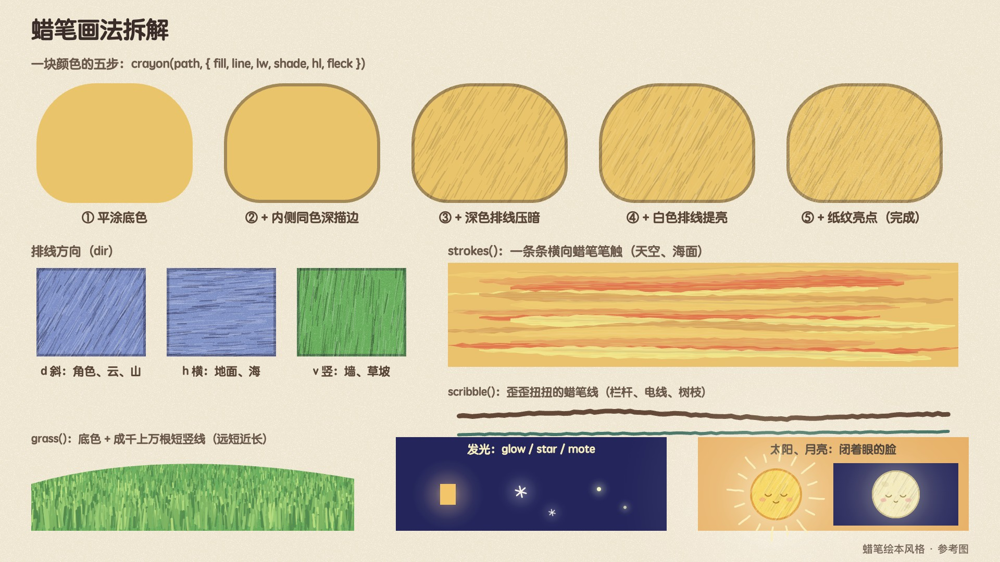
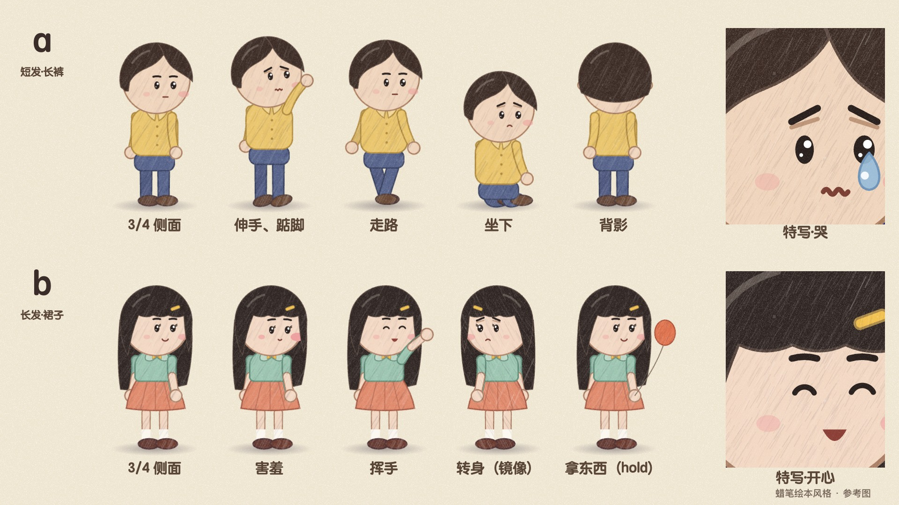
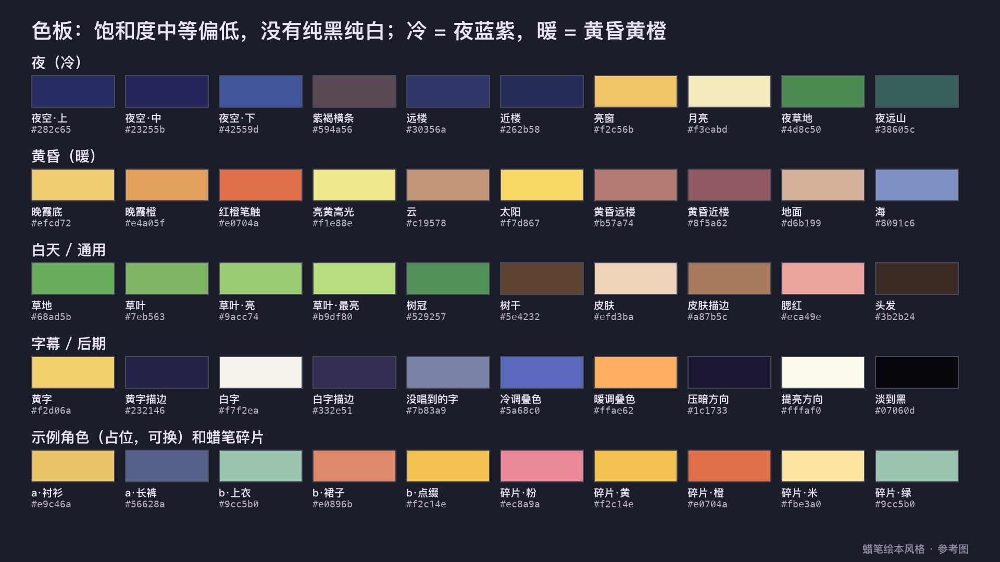
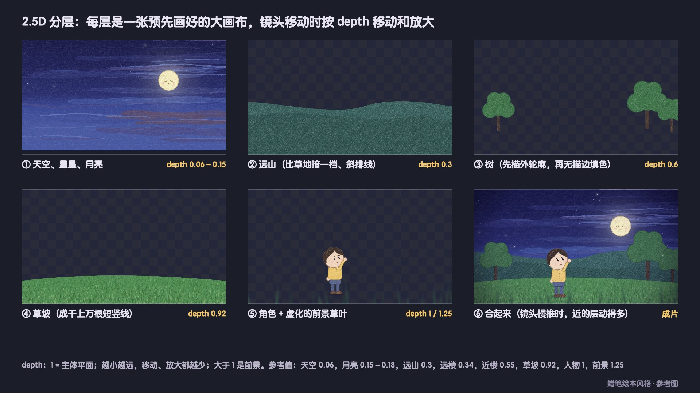
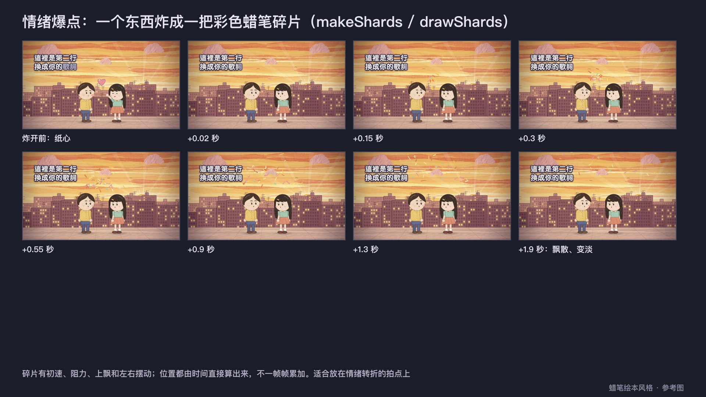
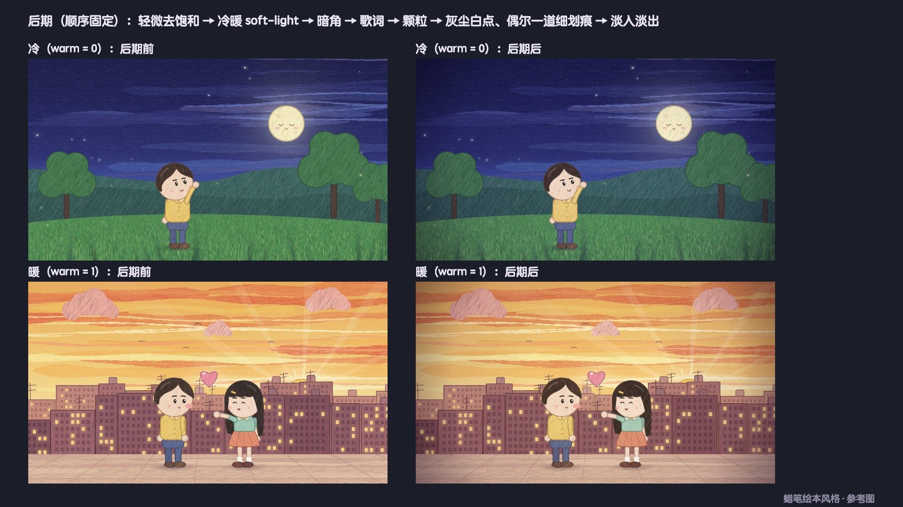

# 蜡笔绘本版（crayon）

起步代码在本 skill 的 `assets/crayon/`，用 `new_project.py --style crayon` 建项目，模板渲染验证过。参考图在 `references/style-crayon/`。

这份文档只记风格：画法、配色、镜头、节奏、转场、字幕、后期，以及代码怎么写。人物、地点、画面上的字和故事，都由新片自己定。

- 参数是在 1920×1080、30 fps、慢歌（约 80–90 BPM）下调出来的。快歌把镜头时长按拍等比缩短。
- 标"已验证"的写成过代码，渲染出来看过；标"待验证"的只观察过，下面写的做法是建议。
- 参考图都是用起步代码新画的示意图，不是任何成片的截图。两个角色 a、b 和所有场景都只是占位。

目录：一句话 · 适合做什么 · 画风规则 · 配色 · 镜头 · 节奏和转场 · 情绪爆点 · 字幕 · 后期 · 代码结构 · 接口速查 · 写一个镜头 · 套到新内容 · 不要做的事 · 踩过的坑

## 一句话

像小朋友用蜡笔和彩铅画的绘本，做成 2.5D 动画。

平涂色块，内侧描一圈同色系的深边，叠上彩铅排线和纸纹。前景、中景、远景分层，镜头慢推慢移。

冷暖分两套：夜里是蓝紫，黄昏是黄橙。情绪靠天色和冷暖来讲。

## 适合做什么

- 温柔、怀旧、童真的歌：思念、陪伴、成长、离别、小时候。
- 两个人的故事，或者一个人和一个地方的故事。
- 慢歌和中速的歌最合适。快歌也能用，镜头跟着变短，副歌多用快切。
- 不适合冷硬、科技感、霓虹都市、写实的题材。

## 画风规则



**总体（已验证）**

- 平涂加内侧同色系深描边，不用纯黑描边，没有矢量卡通那种干净的硬边。
- 每块颜色都过一遍 `crayon()`：底色 → 内侧深描边 → 深色排线压暗 → 白色排线提亮 → 纸纹亮点。
- 排线方向有分工：
  - 角色、云、山用斜线（约 -60°）；
  - 地面、海用横线；
  - 墙、草坡用竖线。
- 饱和度中等偏低，没有纯黑纯白。压暗往深靛 `#1c1733` 混，提亮往暖白 `#fffaf0` 混。
- 会发光的东西都带柔光晕：太阳、月亮、星星、萤火、窗灯。
- 全片有颗粒、灰尘白点和暗角。

**背景（已验证）**

- 天空：底色上叠很多条长长的横向蜡笔笔触，边缘毛糙、粗细不匀、颜色互相压。
- 云：平涂加斜排线，平底。
- 草地：底色上铺成千上万根短竖线，远处短而细，近处长而粗。最前面放一排虚化的大草叶当前景。
- 远山：比草地暗一档，加斜排线。
- 树：几团圆拼成树冠。先把所有圆一起描一圈外轮廓，再不描边地填色，树冠里就不会露出一圈圈的线。
- 楼：方块楼身加一格格窗，少数窗亮暖灯。远的一层加一层雾色，才"退"得下去。
- 分层：天空、远山或远楼、中景、人物、前景各一层，镜头移动时各层速度不同。
- 特写时背景虚化（景深）。

**人物（已验证）**



- 极简 Q 版：圆头、豆子形身体、短手短脚，手是小圆球，脸占画面的主要部分。
- 手臂要短，伸出去的手和垂下的手一样长。手肘画成经过肘部的圆弧，不折成硬角。
- 表情靠四样：
  - 粗短的眉毛（发愁时往里、往下压）；
  - 黑豆眼加两个白高光；
  - 波浪线的嘴；
  - 粉色椭圆腮红。
- 身上叠一层白色斜划痕和小白点，像彩铅在纸上留下的空隙。
- 太阳、月亮画成闭着眼的脸。
- 长发角色不画背影：头发会把整个身子盖住，看着像鬼。转身直接镜像（`flip`）。
- 道具贴着手画（`hold`），不挡脸，不飘在半空。
- 每个角色一种专属色，全片不换，观众靠它认人。

**动态的东西（已验证）**

- 情绪转折：一个东西炸成一把彩色蜡笔碎片，飘散（见"情绪爆点"）。
- 流星、萤火、音符、落叶、裂缝、对话气泡，都在 `fx.js` 里，全部由时间直接算出位置。
- 时间流逝不切镜头：同一个镜头里画两张天空层（黄昏、夜），按时间交叉淡化，再把窗灯一盏盏点亮（`drawWindowLights`）。

**待验证**

- 奔跑时加横向的白色速度线、脚下小烟团。

## 配色



**夜（冷）**

| 用途 | HEX |
|---|---|
| 夜空 | 上 `#282c65` `#23255b` `#1e1f4f`，下 `#42559d` `#3a4991` `#353d7b`；紫褐色横条 `#594a56` |
| 远楼 / 近楼 | `#30356a` `#353a72` `#2c3163` / `#262b58` `#2b305f` `#23274f`；描边 `#23264f` / `#171a3c` |
| 亮窗 | `#f2c56b`，约 12–17% 的窗亮着 |
| 月亮 | `#f3eabd`，描边 `#cdbd86`，大光晕 |
| 星星 | `#f8f4ed` |
| 草地 | 底 `#4d8c50`，草叶 `#68965c` `#83af6d` `#3a6741` `#457949` |
| 远山 / 树冠 | `#38605c` `#2f5450` / `#3f7449` |
| 海 | `#2f3a78`，笔触 `#3a4689` `#283166` `#46539a`，月光倒影 `#d8d4a8` `#f3eabd` |
| 萤火 | `#e8f0a0` |

**黄昏（暖）**

| 用途 | HEX |
|---|---|
| 晚霞 | 底 `#efcd72` `#eac26e` → 橙 `#e4a05f` `#d5a15c`；红橙笔触 `#e0704a`；亮黄高光 `#f1e88e` `#f2dca3` |
| 云 | `#e6a495` `#e9a99a` `#ebb1a2`（粉），加密斜排线 |
| 太阳 | 芯 `#f7d867`，描边 `#e2a243`，光芒 `#fbf0bc`，大光束半透明 |
| 远楼 / 近楼 | `#b57a74` `#c0857a` `#a96f6f` / `#8f5a62` `#9a6268` `#83505a` |
| 地面 | `#d6b199`，笔触 `#dcbaa2` `#cfa48f` `#e3c4ab` |
| 海 | `#8091c6`，笔触 `#93a3d4` `#6d7db9` `#a8b5df`，夕阳倒影 `#f6c46a` `#fbe3a0` `#f2a868` |
| 远山 | `#a88a9e` `#9b7f95`（粉紫） |

**白天 / 通用**

| 用途 | HEX |
|---|---|
| 草地 | 底 `#68ad5b`，草叶 `#7eb563` `#9acc74` `#b9df80` `#528b4d` |
| 远山 | `#5f8f62` `#557f58` |
| 树 | 树冠 `#529257`，树干 `#5e4232` |
| 皮肤 | `#efd3ba` / `#f2d7c2`，描边 `#a87b5c`，腮红 `#eca49e` |
| 头发 | `#3b2b24` `#2f2522`（几乎是黑，但不是纯黑） |
| 眼泪 | `#97bbd9` |

**示例角色（占位，可换）**：a 衬衫 `#e9c46a`、长裤 `#56628a`；b 上衣 `#9cc5b0`、裙子 `#e0896b`、点缀 `#f2c14e`。

**规律**：前半段或"现在"偏冷，回忆和温暖的时刻偏暖；草地一直是主色。

## 镜头



**已验证**

- 镜头 `cam = { x, y, z }`：看着主体平面上的 (x, y)，放大 z 倍。一般从 `{ x: 960, y: 540, z: 1 }` 慢推到 `z ≈ 1.05–1.07`。
- 每层一个 depth：1 是主体平面，越小越远（移动、放大都越少），大于 1 是前景。参考值：

  | 层 | depth |
  |---|---|
  | 天空 | 0.06 |
  | 星星 | 0.08–0.1 |
  | 月亮、太阳 | 0.15–0.18 |
  | 远山、远楼 | 0.3–0.34 |
  | 近楼 | 0.5–0.55 |
  | 树 | 0.6 |
  | 草坡、地面 | 0.9–0.92 |
  | 人物 | 1 |
  | 前景 | 1.25 |

- 每个镜头只做一种慢动作：慢推、慢移或跟随角色，用 `ease.sine` 走完整个镜头。不要来回推拉。
- 布景层要比画面大一圈：一般从 (-260, -180) 开始，宽 2440，往下画到 1300 以上。镜头一动才不会露出底色。
- 特写：背景用 `blurLayer` 虚化，最底下先铺一层底色。情绪最强的地方用近景，脸占画面大半。

## 节奏和转场

**已验证**

- 镜头长度：
  - 主歌：1.2–6.5 秒，一个镜头一种慢动作。
  - 情绪推高：0.7–1.25 秒连续快切，一拍一刀。
  - 情绪最高：一个 5–6 秒的长特写，比如眼泪慢慢变大、抬手擦掉，背景虚化。
  - 收尾：拉回中景、远景。
- 切点卡在开唱点或拍点上（`timing.beats`），硬切。每一刀都要有原因：视线（人物看 → 切到他看的东西）、动作（迈步 → 脚步特写），或者同一个东西出现在前后两镜。
- 前后两镜的天色、时间要和歌词一致；人物的姿势、表情要接得上上一镜的情绪。
- 不用整屏叠化。开头约 1 秒从黑淡入，结尾约 1.5 秒淡到黑。
- 帧率：30 fps，逐帧连续。"一拍二"（每秒只换 12 张画）有手工的顿挫感，但动作看起来卡，默认关掉（`main.js` 的 `SMOOTH`）。不要用插帧：代码能直接算出中间帧，插帧反而会有果冻效应。

## 情绪爆点（已验证）



- 一个东西（人物、纸心、气球……）在拍点上炸成一把彩色蜡笔碎片：
  - 有初速、阻力、上飘和左右摆动，约 2.5 秒飘散变淡；
  - 碎片颜色取画面里的主色，再加一两个亮色。
- 写法：碎片列表在布景里建一次（`useSet` 里 `makeShards(...)`），每帧 `drawShards(g, list, lt - 炸开时刻)`。
- 一支片最多用两三次，放在情绪转折最大的地方。

## 字幕


**已验证**

- 字体：圆体粗体。繁体歌词用 `Yuanti TC Bold`，简体用 `Yuanti SC Bold`；`index.html` 里的 `@font-face` 叫 `MVRound`。
- 两套颜色：
  - 夜景：黄字 `#f2d06a` 加深蓝描边 `#232146`（`ink: "yellow"`）。
  - 黄昏、暖色段落：白字 `#f7f2ea` 加深紫灰描边 `#332e51`（`ink: "white"`）。
  - 字面上有斜向蜡笔纹，带柔和投影。
- 卡拉 OK 逐字刷色：
  - 整句先用半透明灰蓝（`#7b83a9`）出现；
  - 唱到哪个字，哪个字刷成实色；
  - 每个字的时长按乐句长度平均分；
  - 最后一个字拖长音时慢慢刷完。
- 一次只显示一行，一行里的两个乐句上下叠放。
- 位置跟着构图走，放在画面空的地方，不固定在底部。同一行在快切里不挪位置。
- 字号：普通句 82 px，重点句约 88 px，片名 150 px。
- 交接：上一行在下一行开唱前约 0.55 秒淡完（`until`），新一行提前 0.3 秒出现（`from`），两行不会叠在一起。
- 字幕画在后期那一步，不跟镜头动。

## 后期（顺序固定）



1. 轻微去饱和：`saturate(0.92) contrast(1.03)`。
2. 冷暖：soft-light 叠一层颜色，冷 `#5a68c0`、暖 `#ffae62`，强度 0.14。镜头的 `warm` 在 0 和 1 之间，可以随时间变。
3. 暗角：multiply，四角暗 20–25%。
4. 画歌词。
5. 颗粒：overlay，强度 0.07，每帧换一个位置（按帧号种子随机，能复现）。
6. 灰尘白点，偶尔一道细划痕。
7. 淡入淡出。

## 代码结构（`assets/crayon/`）

```
index.html             根合成：一张 1920×1080 的 canvas + <audio id="song">；@font-face MVRound（圆体粗体）
                       注册一条空的、暂停的 GSAP 时间轴 window.__timelines["main"]
data/timing.json       拍点、小节线、乐句（beats.py、set_lyrics.py 会重写它）；src/data/timing.js 由它生成
src/main.js            分镜表 SHOTS、每行歌词的位置和颜色 LY、淡入淡出、renderAt(t)
                       window.__hf.buildReady["mv-stage"] 先等字体加载、纹理生成；hf-seek 事件里画当前帧
src/util.js            mulberry32、clamp01、lerp、ease、ramp、keyed、wobble
src/crayon.js          画法：纹理、crayon()、strokes()、scribble()、grass()、glow()、star()、mote()、sleepyFace()、waxify()、镜头分层
src/shot.js            shot()（镜头外壳）、useSet()（布景缓存，最多同时留 6 套）
src/post.js            后期：createPost().finish()
src/lyrics.js          卡拉 OK 歌词：drawLyrics()
src/art.js             通用美术：夜空、晚霞、暮色、云、月亮、太阳、光束、楼群、心、海鸥、盆栽、星星、窗灯、弯月
src/fx.js              动态小物件：蜡笔碎片、音符、落叶、裂缝、流星、信封、纸团、对话气泡、照片、挂钟
src/sets.js            示意布景：城市天际线、远山、草坡、树、海、地面、楼外墙和主窗、前景草叶
src/character.js       示意角色：drawPerson(ctx, "a"|"b", x, y, h, pose)
src/scenes/example.js  两个示例镜头：nightHill（夜·草坡，冷）、duskMeet（黄昏·城边，暖）
tools/sheet/           角色设定图页面
```

- `character.js` 的两个角色、`sets.js` 的布景、`scenes/example.js` 的两个镜头是示意内容，新片换成自己的。其余是通用代码。
- 每一帧只由时间 t 决定。HyperFrames 会乱序、并行地渲染任意一帧，所以：
  - 随机数都用带种子的 `mulberry32`；
  - 粒子位置写成时间的公式，不一帧帧累加；
  - 不用 `Math.random`、计时器、`requestAnimationFrame`。
- 渲染：`npx --yes hyperframes@0.9.41 render --fps=30 --max-bitrate=16M`。颗粒多，码率要给够。M4 上 2 分钟整片实测 2–11 分钟；16 秒的模板演示连启动约 2.5 分钟。
- 检查：`npx --yes hyperframes@0.9.41 check`。`font_face_local_only` 警告本机渲染可以忽略；换机器渲染，要把字体文件放进 `assets/fonts/`。

## 接口速查

**画法（`crayon.js`）**

- `crayon(ctx, path, { fill, line, lw, shade, hl, fleck, k, dir })`：蜡笔平涂一个 Path2D。
  - `line` 默认是 `darker(fill, 0.34)`；`lw` 是描边宽度，0 就不描。
  - `dir`："d" 斜、"h" 横、"v" 竖。
  - `k` 是纹理缩放：在缩放过的坐标系里画时用 1/scale，屏幕上的纹理密度才对。
- `strokes(ctx, [{ x0, x1, y, th, amp, freq, color, alpha }], { streak, seed })`：一组横向蜡笔笔触，用于天空、海面、地面。
- `scribble(ctx, [[x, y], …], { color, width, seed, jitter })`：歪歪扭扭的蜡笔线，用于栏杆、电线、树枝。
- `grass(ctx, region, { base, blades, x0, x1, y0, y1, density })`：草地。
- 发光和脸：
  - `glow(ctx, x, y, r, color, a)`：柔光；
  - `star(ctx, x, y, s, tw)`：星星；
  - `mote(ctx, x, y, r, color, a)`：发光颗粒；
  - `sleepyFace(ctx, x, y, r, opts)`：闭眼的脸。
- `waxify(ctx, amount)`：给整层抠出细小空隙，让下面的东西透出来一点。
- `textures()`：生成纹理，在 build 里调一次。`pat(ctx, name, k)`：取纹理图案（tooth、streak、hatchW/K/V/WV/KH/WH、scratch）。
- 颜色：`rgba(hex, a)`、`mix(a, b, k)`、`darker(hex, k)`、`lighter(hex, k)`、`pick(rnd, list)`。

**镜头分层（`crayon.js`）**

- `makeLayer(x, y, w, h, draw)`：预先画好的一层，世界坐标。范围要包住要画的所有东西，超出的部分会被切平。
- `drawLayer(ctx, cam, depth, layer, alpha)`、`withCam(ctx, cam, depth, c => …)`：按深度画一层，或者在某个深度上直接画会动的东西。
- `blurLayer(layer, px)`：一层的虚化版本，用于景深。
- `onTwos(t)`：一拍二，默认不用。

**镜头外壳（`shot.js`）**

- `shot({ id, tIn, tOut, warm, draw(g, lt, T) })`：`lt` 是镜头内的时间，`T` 是整片时间。`warm` 在 0（冷）和 1（暖）之间，也可以写成 `lt => 数值`。
- `useSet(key, build)`：布景只在第一次用到时才画，key 相同的镜头共用，最多同时留 6 套。

**角色（`character.js`）**

`drawPerson(ctx, who, x, y, h, pose)`：x, y 是脚底中点，h 是身高（像素）。`who` 是 `LOOK` 里的名字。设计稿身高约 1000，默认 3/4 侧面朝右。

| pose | 意思 |
|---|---|
| `mood` | neutral、smile、happy、shy、sad、worry、surprise、cry、sing |
| `gaze: [x, y]`、`blink`、`lid`、`tilt`（负数是仰头）、`lean` | 视线、眨眼、眼皮、头歪、上身前倾 |
| `reach`（0–1）、`reachAng` | 伸手和角度 |
| `lift` | 踮脚 |
| `walk` | 走路的相位 |
| `promise` | 勾手指 |
| `wipe` | 擦眼泪 |
| `sit`、`perch` | 坐下、坐在高处，小腿垂下来 |
| `handN` / `handF: [x, y]` | 把手放到指定位置，比如搭在窗台上 |
| `hold: (ctx, x, y) => …` | 在近侧手的位置画道具，设计坐标，跟着角色缩放、镜像 |
| `tear`、`tearFall`、`cheekTears` | 眼泪 |
| `flip` | 朝左（镜像） |
| `view: "back"` | 背影，只对 shirt 体型有效 |
| `shadow`、`scratch`、`bob` | 脚下软影子、白划痕强度、上下晃 |

- 加角色：在 `LOOK` 里加一条，`build` 选 "shirt"（短发、衬衫、长裤）或 "dress"（长发、上衣、裙子、袜子），再填颜色。
- 角色先画在一张离屏画布上，范围是 `BOX = { x0: -470, x1: 600, y0: -1130, y1: 220 }`（设计坐标），要包住所有姿势。新加动作时，先确认没有超出这张画布。
- 手臂、腿用 `tube(a, c, b, 粗, 细)`：沿二次曲线画的圆头管子，手肘不会折成硬角。

**歌词（`lyrics.js`）**：`drawLyrics(ctx, { phrases, x, y, size, ink, align, gap, until, lead }, t)`。

**后期（`post.js`）**：`post.finish(out, { frame, warm, fade, lyrics: ctx => … })`。

## 写一个镜头（照 `src/scenes/example.js`）

```js
export function nightHill({ tIn, tOut }) {
  return shot({ id: "night-hill", tIn, tOut, warm: 0, draw(g, lt, T) {
    const S = nightSet();                                                // useSet 缓存的布景
    const k = ease.sine(Math.min(1, lt / (tOut - tIn)));                 // 整个镜头只做一种慢动作
    const cam = { x: 960 + 30 * k, y: 540 - 20 * k, z: 1 + 0.06 * k };
    drawLayer(g, cam, 0.06, S.sky);                                      // 远 → 近，一层层画
    withCam(g, cam, 0.15, (c) => moon(c, 1380, keyed([[0, 430], [6.5, 300]], lt), 96));
    drawLayer(g, cam, 0.3, S.hills);
    drawLayer(g, cam, 0.92, S.hill);
    withCam(g, cam, 1, (c) => drawPerson(c, "a", 820, 990, 460, { reach: keyed([[2.2, 0], [2.9, 1]], lt), mood: "smile" }));
    drawLayer(g, cam, 1.25, S.fg);                                       // 虚化的前景
  }});
}
```

然后在 `main.js` 的 `SHOTS` 里按时间排好：`nightHill({ tIn: L(3), tOut: L(4) })`。切点用开唱点 `L(n)`，或者 `timing.beats` 里的拍点。每行歌词的位置和颜色写在 `LY`。

## 套到新内容

1. 定冷暖线：哪些段落是"冷"（夜、现在、孤单），哪些是"暖"（黄昏、回忆、温暖的时刻）。冷暖可以当情绪线，结尾回到开头的冷暖，首尾呼应。
2. 定角色：
   - 改 `LOOK` 里两个示例角色的颜色，或者照两种体型加新角色；
   - 每个角色一种专属色，全片不换；
   - 用 `tools/sheet` 出设定图，先给用户确认。
3. 定场景：用 `sets.js` 的布景拼，或者照它的写法画新地点。新东西也按"平涂 + 内侧描边 + 排线方向 + 纸纹"来画，才和整体一致。
4. 分镜：
   - 每行歌词至少一个镜头；
   - 副歌一拍一刀快切；
   - 情绪最高处用长特写或蜡笔碎片；
   - 时间流逝用同一个镜头里的天色变化。
5. 字幕位置按每个镜头的构图逐行定（`main.js` 的 `LY`）。
6. 流程照本 skill 的六步：
   1. 用 `new_project.py --style crayon` 建项目，模板自带两个示例镜头；
   2. 先做一段约 6 秒的样片，对齐风格；
   3. 出角色设定图；
   4. 逐镜做，先出关键帧总览；
   5. 总览确认后再渲整片。

## 不要做的事

- 生图模型；纯黑描边、矢量卡通感；霓虹色、紫色渐变；满屏文字。
- 整屏叠化；一个镜头里来回推拉；插帧。
- 长发角色的背影。
- 把东西画在比它小的图层上。
- 一个镜头里塞好几个动作：一句歌词一个主要动作。

## 踩过的坑

1. **"一拍二"看着卡。** 改成 30 fps 逐帧连续，不用插帧。
2. **东西被图层的边切平。** 比如树冠只剩半截。`makeLayer` 的范围要包住树冠最高点。树冠如果每个圆都描边，里面会露出很多圈线，所以先整体描外轮廓，再不描边填色。
3. **角色坐下时脚没了。** 离屏画布 `BOX` 的下边要包住坐姿时垂下的小腿和鞋（y1 至少 220）。
4. **画面的时间和歌词对不上。** 比如夜里的歌词配了一个像白天的暖黄画面。暖色可以给回忆，但白天还是夜里要和歌词一致；只想要一点暖，就只让一扇窗亮暖灯。
5. **人物突然出现。** 上一镜只拍天空，下一镜人物突然冒出来，还马上出事。要么用一个连贯的镜头拍完，要么让人物在上一镜就已经在画面里；出事之前留 1 秒以上的铺垫。
6. **快切里不连贯。** 人物像被拖着平移，手一直伸着；下一镜又笑了，像什么都没发生。每一刀的姿势、表情都要接得上上一刀的情绪。
7. **歌词压在脸上。** 快切的特写里，人脸要避开那一行歌词的位置。
8. **线状特效像水管或树枝。** 比如天空里的裂缝。做成有宽度的缝，上沿描一道亮边，碎片少而大，分叉不要戳到人物头上。
9. **镜头一动就露出黑边。** 背景层往外补够，最底下先铺一层底色。
10. **两行歌词叠在一起。** 用 `until` 让上一行提前淡完。
11. **推进时被前景挡住。** 推进镜头里，让前景层往下滑出画面。
12. **窗里的人太小。** 用中近景，人物放大，手搭在窗台上（`handN`、`handF`）。
13. **布景太多，内存撑爆。** `useSet` 最多同时留 6 套，旧的释放掉。
14. **Chrome 的 canvas 里，`filter = blur()` 加 `destination-in` 不可靠。** 先把遮罩模糊到一张单独的画布上，再用 `drawImage` 加 `destination-in` 合成。
15. **第一帧字体不对。** `build()` 里先 `await document.fonts.load('700 80px "MVRound"')`，再开始画。
