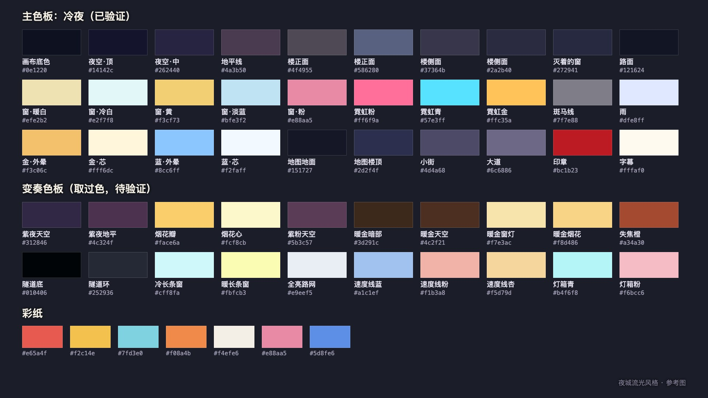
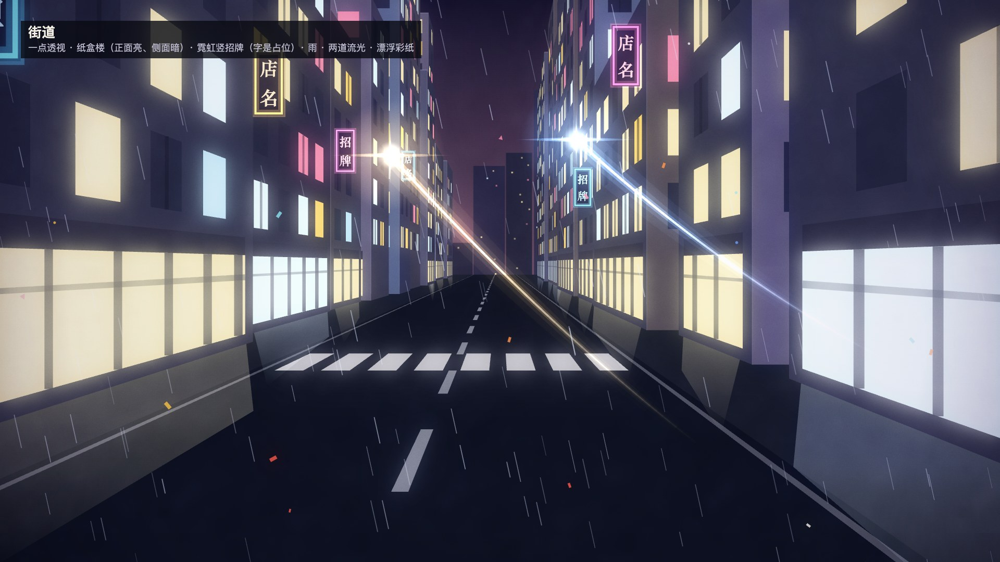
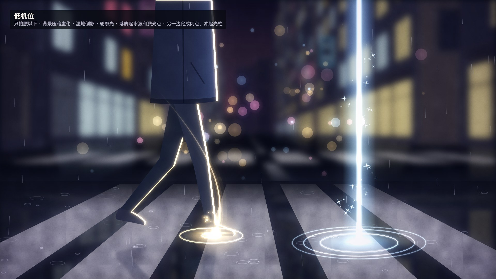
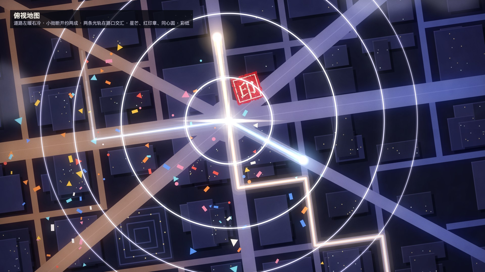
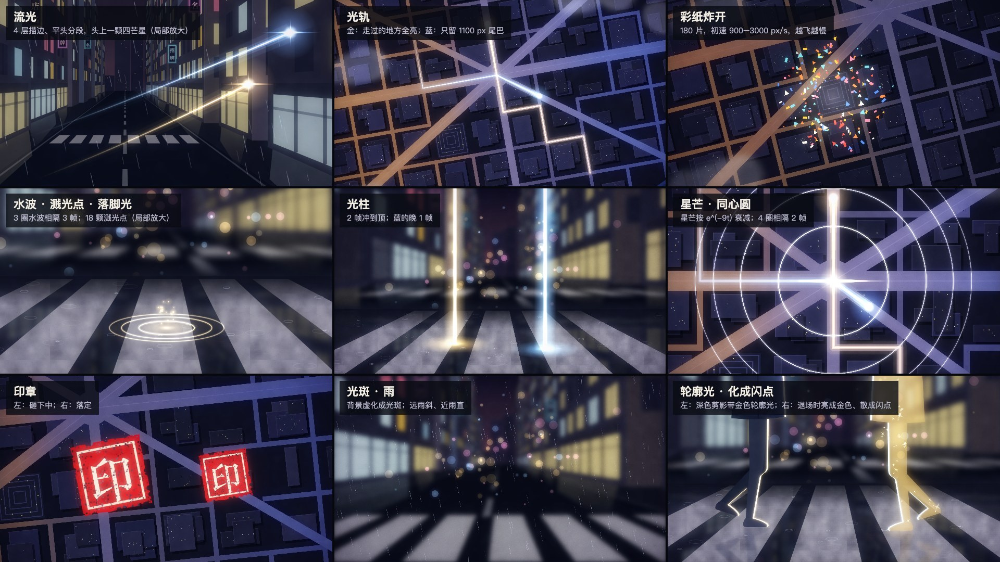
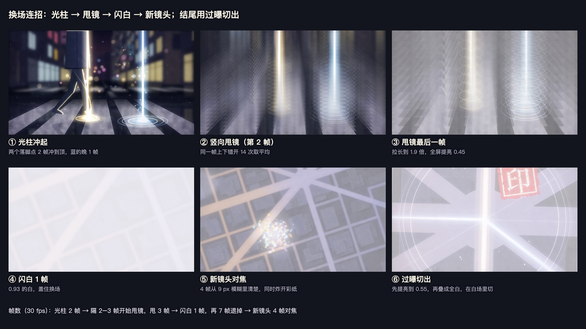
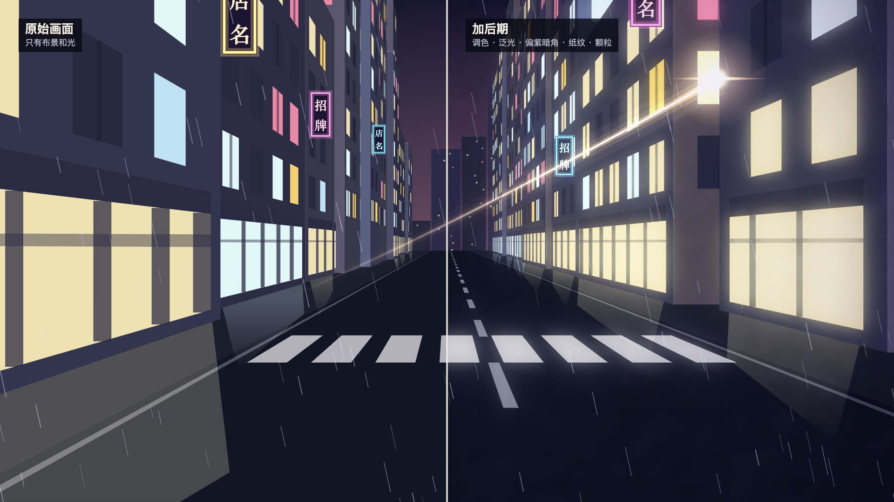

# 夜城流光版（nightcity）

起步代码在本 skill 的 `assets/nightcity/`，用 `new_project.py --style nightcity` 建项目，模板渲染验证过。参考图在 `references/style-nightcity/`。

这份文档只记风格：画法、配色、镜头、节奏、动效、转场、字幕、后期，以及代码怎么写。人物、地点、画面上的字和故事，都由新片自己定。

- 参数是在 1920×1080、30 fps、约 140 BPM 下调出来的。
- 标"已验证"的写成过代码，渲染出来看过。
- 标"待验证"的只观察过，下面写的做法是建议。
- 参考图都是用这套代码新画的示意图，不是任何成片的截图。招牌字是占位，人物和地图路线也只是示意。

目录：一句话 · 适合做什么 · 画风规则 · 配色 · 镜头 · 节奏和连招 · 动效 · 转场 · 其他画面手法 · 字幕 · 后期 · 代码结构 · 接口速查 · 写一个镜头 · 关键代码 · 套到新内容 · 不要做的事 · 踩过的坑

## 一句话

雨夜城市的扁平插画，像一层层纸片搭出来的 2.5D 舞台。深蓝紫的底色上点着暖白窗灯。

一金一蓝两道流光代表两条线索，在街上、地图上穿行、交汇。交汇时冒星芒、砸红印章、扩散同心圆。

换场靠闪白、甩镜、猛推和过曝。字幕用宋体粗体，一个字一个字亮起来，最关键的字盖成红印章。

## 适合做什么

- 两个人或两件事的路线：相遇、错过、追赶、重逢。
- 城市夜景、夜归、旅行路线，或者把几个地点连起来。
- 节奏明快的歌或剪辑。慢歌把所有时长按拍等比放长。
- 不适合白天、田园、温馨日常。这套颜色和光效都是为夜里设计的。

## 画风规则

**总体**

- 扁平色块，不描黑边。物体靠明暗两个面区分：正面亮，侧面暗。
- 2.5D 分层：楼、招牌、云、彩纸各在一层。镜头前推时近层放大得快，形成视差。
- 会发光的东西都带柔光晕，包括窗、流光、光柱、星芒。
  - 这些都用叠加模式（`lighter`）画。
  - 后期再整体泛一次光。
- 暗部占画面七八成，亮的只有灯、光和字。饱和度中等，效果靠亮度对比。
- 全片有细颗粒、纸纹和很轻的偏紫暗角。
- 雨：细长斜线，半透明白。近景换成短而稀的雨，地上有小水波。

**颜色分工**

- 金和蓝各代表一条线索，全片不换。线索可以是一个人、一种选择或一段路。
- 红只给印章，最多再给一个关键人物或物件。
- 冷暖分区：同一画面里常常左暖右冷，比如地图上的道路、分屏的两面墙。

**人物**

- 平涂剪影，一两种颜色，不画五官细节。
- 轮廓光勾边：金色线索的人勾金边，蓝色线索的人勾蓝边。
- 出场：先被流光描出轮廓。剪影先是亮奶油色，约 6 帧变成实色。
- 退场：化成同色闪点，往上飘散。
- 动作要带光。落脚时：
  - 落脚处起水波、溅光点；
  - 地上留一小片光；
  - 最后冲起光柱。
- 低机位只拍腰以下，用脚步代表人物。

**城市布景**

- 街道（已验证）：
  - 一点透视，消失点在画面正中、略偏上（y≈500）。
  - 楼像纸盒：朝路的侧面暗，朝镜头的正面亮，正面顶上一道淡亮边。
  - 窗：约六成亮着，一半带一根竖窗棂。灯色以暖白为主，冷白、黄、淡蓝、粉点缀。
  - 一楼店面：一整条亮窗，每隔一段一根竖窗格，上方一条深色招牌带。
  - 楼头竖招牌：深色底板，霓虹描边（粉、青、金），宋体竖排白字，字带同色辉光。
  - 远处天际线剪影带零星窗点；地平线一圈暖光。
  - 路面深蓝黑，中线是白色虚线，边线淡灰，斑马线纸灰色带纸纹。
- 俯视地图（已验证）：
  - 深色地面上一块块楼顶，带投影和左上亮边，楼顶上有零星窗点。
  - 道路分级：小街细而暗，大道宽而亮。几条大道斜着穿过主路口，路口是一个圆。
  - 小街随机断掉约两成，拼出大小不一的街区。光轨要走的路段必须保留。
  - 道路左暖右冷；云影慢慢飘过；河是两层深蓝粗线。
  - 矢量绘制，每帧按镜头重画，推到 5 倍以上也清楚。

## 配色



**主色板：冷夜（已验证）**

| 用途 | HEX |
|---|---|
| 画布底色 | `#0e1220` |
| 夜空 | `#14142c` → `#262440` → 地平线 `#4a3b50`；地平线暖光 `rgba(150,100,118,0.5)` |
| 楼正面 | `#4f4955` `#586280` `#4a4b66` `#5b5670` |
| 楼侧面 | `#37364b` `#2c2d45` `#33344d` `#2a2b40` |
| 窗 | 灭的 `#272941`。亮的按比例：暖白 `#efe2b2` 36%，冷白 `#e2f7f8` 24%，黄 `#f3cf73` 18%，淡蓝 `#bfe3f2` 12%，粉 `#e88aa5` 10% |
| 店面 | 亮窗 `#efe2b2` / `#e2f7f8`，招牌带 `#2a2a42`，窗格 `rgba(42,42,66,0.75)` |
| 霓虹招牌 | 底板 `#1a1530`；霓虹粉 `#ff6f9a`、青 `#57e3ff`、金 `#ffc35a` |
| 天际线 | 楼 `#2c2a46` / `#26263d`，窗点 `#e9d9a6` `#cfe9f2` `#e88aa5` |
| 路面 | 车道 `#121624`，人行道 `#1b1e2d`，中线 `rgba(165,168,180,0.7)` |
| 斑马线 | 近景：纸灰 `#7f7e88` 叠纸纹；远景：`rgba(196,195,202,0.9)` |
| 湿地面 | `rgba(22,25,38,0.96)` → `#0b0e18` |
| 雨 | `#dfe8ff`，透明度 0.2–0.5 |
| 金线索 | 外晕 `#f3c06c`（地图上 `#f2b85e`），芯 `#fff6dc`；轮廓光 `#ffd58a`；光柱 `#ffcf70` |
| 蓝线索 | 外晕 `#8cc6ff`（地图上 `#7fbfff`），芯 `#f2faff`；轮廓光 `#8fd3ff`；光柱 `#8ccfff` |
| 彩纸 | `#e65a4f` `#f2c14e` `#7fd3e0` `#f08a4b` `#f4efe6` `#e88aa5` `#5d8fe6` |
| 背景光斑 | `#ffcf7a` `#ffe2a6` `#a9d8ff` `#f39ab8` |
| 地图 | 地面 `#151727`；楼顶 `#23243e` `#292b48` `#1e2036` `#2d2f4f` `#26284a`；窗点 `#dcc98f` / `#d8eadd`；小街 `#4d4a68`；大道 `#6c6886`；河 `#2c3f72` / `#22335f`；云 `#e3e5f1`（透明度 0.3） |
| 地图冷暖 | 左暖 `rgba(182,128,70,0.78)`，右冷 `rgba(72,98,176,0.62)` |
| 印章 | `#bc1b23`，斑驳 `#8b151e`，框 `#ead9c6`，字 `#efe2d1` |
| 字幕 | 字 `#fffaf0` → `#eadfca`；金字 `#ffe9a8` → `#e9b75a`；晕影 `rgba(16,12,28,0.9)`；虚影 `#d6cff3` |
| 闪白 / 提亮 | `#f7f5fb` / `#fffaf2` |
| 暗角四角 | `#a49cb6`（multiply） |

**变奏色板（取过色，待验证）**

| 气氛 | HEX |
|---|---|
| 紫夜 | 天空 `#1e1d36` → `#312846` → `#4c324f`；楼 `#303143` `#1e2032` `#4d4a52`；窗灯 `#f7f1b4` `#dbc390` `#c9edfa` `#8daccf` |
| 冷夜里的花形烟花 | 花瓣 `#face6a`，花心 `#fcf8cb`，暗边 `#ba8873` |
| 暖金夜景 | 暗部 `#2b1d14` `#3d291c` `#563925` `#835f3b`；天空 `#4c2f21` → `#352219`；窗灯 `#f7e3ac`；烟花 `#f8d486` / `#faf4d0` |
| 紫粉雨夜 | 天空 `#21203c` → `#412f4c` → `#5b3c57` |
| 隧道 | 底 `#010406`，环 `#252936` / `#1a1f2a` |
| 横移长条 | 冷：主体 `#242b43` / `#39435d`，亮窗 `#cff8fa`，腰线 `#4f80cc`。暖：主体 `#323038`，亮窗 `#fbfcb3`，腰线 `#d2a356` |
| 速度线 | 底 `#0c101c` → `#2f354d`；线：蓝 `#a1c1ef`、粉 `#f1b3a8`、杏 `#f5d79d`、米白 `#f1d9bd` |
| 灯箱 | 青 `#b4f6f8` / `#96e0e6`，黄 `#faf4bb`，粉 `#f6bcc6`；底 `#313a4c` / `#181e2c` |
| 失焦色团 | `#a34a30` `#b6512f` `#824339`，浮在 `#20203e` / `#392c45` 上 |
| 全亮路网 | 路 `#e9eef5` `#c1c7df` `#99a3c7`；地面 `#17192b` / `#2b2a43` |

## 镜头

**已验证**

| 镜头 | 做法 |
|---|---|
| 街道前推 | 镜头在路中央，越推越快：`z = 5 + 9.6t + 2.4t²`。高度从 4.4 降到 3.5（路宽是 12），左右轻晃 ±0.3。焦距 1100 px，地平线 y 从 498 移到 522。两道流光约 1 秒划过全屏，彩纸从消失点往外扩散。 |
| 下沉 | 最后 4 帧（0.14 秒）：镜头高度再降 2.7，往前多冲 8，地平线下移 36 px，整帧模糊 0→12 px，然后硬切。 |
| 低机位 | 镜头高 0.62，焦距 1260，地平线 y=512，慢慢前移、横移。背景用 `blur(12px) brightness(0.68) saturate(1.15)` 压暗虚化，叠一层光斑。下面 35% 是湿地面：背景倒影、人物倒影、往消失点收拢的斑马线、雨点小水波。 |
| 俯视地图 | 运镜见下表。光轨、彩纸、印章画在地图坐标里，跟着地图一起转、一起缩放。星芒和同心圆画在屏幕坐标里，大小不受缩放影响。 |
| 震屏 | 从印章落下那一刻起，持续 0.25 秒。x 振幅 13 px、27 Hz，y 振幅 9 px、21 Hz，按 `e^(-18t)` 衰减。 |





俯视地图运镜（时间从闪白那一帧算起）：

| 时间 | 缩放 | 旋转 | 镜头对准 | 这一段 |
|---|---|---|---|---|
| 0 | 1.6 | −22° | 彩纸炸开的地方 | |
| 0.46 秒 | 0.78 | −12° | 往主路口方向滑 | 先快后慢地拉远，看全局 |
| 1.27 秒 | 0.84 | −9° | 继续慢慢滑 | 匀速 |
| 1.41 秒（4 帧） | 2.05 | 0° | 主路口 | 猛推、转正 |
| 1.94 秒 | 2.22 | 0° | 主路口 | 匀速慢推 |
| 2.46 秒 | 4.6 | 0° → 3° | 主路口 | 先慢后快 |
| 2.64 秒 | 5.8 | 3° | 主路口 | 过曝切出 |



**待验证**

- 下摇：从整面楼摇到街面。
- 横移跟拍长条物体。
- 沿斜线跟着人物往上移。
- 天际线远景，固定机位。

## 节奏和连招

- 30 fps 逐帧连续，不做一拍二。
- 开场密：前 5 秒换 3–4 种景别。之后一段 2–5 秒。
- 大动作卡在拍点或半拍上：落脚、光柱、闪白、猛推、印章、同心圆。
- 下面几种组合（"连招"）可以直接搬。帧数按 30 fps 算。

**连招 A：人物出场（落脚）**

1. 流光从画外沿弧线描到脚尖，约 6 帧，先慢后快。尾巴晚 2–3 帧出发，约 8 帧收完。
2. 落脚那一帧：
   - 水波：3 圈，相隔 3 帧，每圈 22 帧；
   - 溅光点：18 颗，约 13 帧；
   - 地上留一小片光，一直亮到光柱冲起来；
   - 全屏提亮 0.1，4 帧退掉。
3. 剪影从亮奶油色变成实色，约 6 帧。
4. 退场在落脚后约 6 帧。剪影 4 帧内亮成金色，接着 4 帧淡掉；同时冒出约 50 颗闪点往上飘，半秒内散完。
5. 第二个人晚约 1.5 拍出场，换成蓝色，同样走一遍。第二个人的亮色阶段强度只用 0.55。

**连招 B：换场（光柱 → 甩镜 → 闪白）**

1. 两个落脚点同时冲起光柱，2 帧冲到顶；蓝的晚 1 帧。
2. 光柱起来 2–3 帧后开始竖向甩镜，共 3 帧，同时全屏提亮到 0.45。
3. 闪白 1 帧（0.93），之后 7 帧退掉。
4. 新镜头从 9 px 模糊里 4 帧对上焦，同时画面里炸开彩纸。

**连招 C：交汇（高潮）**

1. 闪白后约 6 帧，两条光轨先后出发（先蓝后金，相隔 2 帧）。在地图上每秒走 4–5 个街区，一个街区 240 px。
2. 猛推：4 帧放大约 2.4 倍并转正，对准交汇的路口。
3. 猛推后约 5 帧，主光轨经过路口，冒出星芒：提前 1 帧冒头，然后按 `e^(-9t)` 衰减，约 10 帧。
4. 星芒后约 8 帧，另一条光轨到达。红印章砸下（3 帧落定，再 2–3 帧轻弹），同时震屏。
5. 印章后 3 帧，同心圆扩散：4 圈，相隔 2 帧，每圈 18 帧。
6. 镜头加速推近。印章后约 0.4 秒开始提亮，再过 0.15 秒开始叠白，0.15 秒到全白，在白场里切下一镜。

**连招 D：字幕**：见"字幕"一节。

## 动效（已验证）



| 名字 | 样子 | 参数 |
|---|---|---|
| 流光 | 三次贝塞尔曲线上的一段光，头亮尾淡，头上一颗四芒星 | 4 层描边：宽 42/20/9/3.2，透明度 0.06/0.15/0.42/0.95，最后一层用芯色。越往尾越细越淡。整体缩放 1.5–1.7。头部光晕 62 px，白芯 16 px |
| 光轨 | 沿折线走，走过的地方一直亮着；也可以只留一段尾巴 | 4 层：宽 50/26/12/4.8，透明度 0.06/0.14/0.4/0.92。头部 380 px 一段更亮。只留尾巴时，尾长 1100 px |
| 雨 | 斜线雨 | 远景：240 根，斜率 0.22，2300 px/s，长 26–64。近景：90 根，斜率 0.05，1500 px/s，长 18–42 |
| 漂浮彩纸 | 长条、三角、圆点，随镜头前推从消失点往外扩散 | 46 片，4–13 px，透明度 0.85 |
| 彩纸炸开 | 从一点炸开，越飞越慢，然后淡掉 | 180 片，8–23 px。初速 900–3000 px/s，阻尼 3.2–4.2。0.75 秒后用 0.6 秒淡掉。炸开时中心一团 260 px 暖白光，持续 0.25 秒 |
| 水波 | 透视压扁的椭圆，一圈套一圈 | 扁率 0.24。3 圈，相隔 0.1 秒，每圈 0.75 秒扩到 240–290 px |
| 落脚光 | 地上一小片压扁的光，微微闪 | 半径 120，扁率 0.3 |
| 溅光点 | 从落脚点往上溅，再落下 | 18 颗，横速 ±260 px/s，上抛 260–880 px/s，重力 1300 px/s²，0.45 秒 |
| 光柱 | 从落脚点冲到画面顶 | 半宽 64 px，白芯约 28 px 宽，高 1150 px，0.07 秒到顶。外层同色、中间白，底部一团压扁的光，微微闪烁 |
| 同心圆 | 白色细圆一圈圈扩散 | 4 圈，相隔 0.075 秒，每圈 0.6 秒扩到 880 px。外晕 20→4 px，细线 5.8→1.6 px |
| 印章 | 做旧的红方印，砸下来 | 见"关键代码" |
| 星芒 | 横长竖短的四芒星 | 最长 380 px，竖光是横光的 0.55，按 `e^(-9t)` 衰减 |
| 背景光斑 | 虚化的街灯 | 70 颗，半径 5–27 px，暖黄为主，少量冷蓝和粉 |
| 闪点 | 一群小四芒星，往上飘 | 0.2–0.25 秒内陆续冒出，每颗 0.3–0.8 秒，上升 140–170 px/s |
| 轮廓光 | 人物前进方向那一侧（和上沿）的一条亮边 | 剪影错开 7 px 抠出边。叠两遍：清晰一遍，5 px 模糊一遍 |
| 倒影 | 湿地面上的倒影 | 人物：翻转，4 px 模糊，透明度 0.26。背景：压扁到 0.62 再翻转，10 px 模糊，screen 0.22 |
| 雨点小水波 | 地上一个个小椭圆 | 46 个，周期 0.45–0.95 秒 |

## 转场

**已验证**

| 转场 | 做法 | 时长 |
|---|---|---|
| 闪白 | 1 帧 0.93 白，之后先快后慢退掉 | 1 + 7 帧 |
| 竖向甩镜 | 同一帧上下错开 14 次取平均，第 k 张透明度 1/(k+1)。错开步长 18→88 px，同时竖向拉长到 1.9 倍，全屏提亮到 0.45 | 3 帧，接闪白 |
| 下沉模糊 | 镜头下沉，整帧 0→12 px 模糊，然后硬切 | 4 帧 |
| 进场对焦 | 新镜头从 9 px 模糊里清楚过来 | 4 帧 |
| 猛推 | 放大约 2.4 倍并转正 | 4 帧 |
| 过曝切出 | 先提亮（screen，0.25 秒到 0.55）；提亮开始 0.15 秒后叠白，0.15 秒到全白；在白场里切 | 约 9 帧 |



**待验证**

| 转场 | 做法建议 |
|---|---|
| 窗框扫入 | 一个窗框从画外横扫进来，框里是下一场的虚化画面；镜头穿过窗进入下一场 |
| 速度线 | 满屏横向细线（蓝、粉、杏、米白），长短、粗细、速度都不一样，从一侧扫过去，盖住换场 |
| 失焦 | 画面糊成几团大色块（深蓝紫底上浮着暖橙色团），再从模糊里对焦到下一场 |
| 竖向拉丝 | 只做竖向动态模糊，窗灯拉成一条条竖光，像镜头竖着飞过去 |
| 前景擦过 | 一个大的前景物件（柱子、行人、树枝）横着擦过镜头，擦过以后换成下一镜 |

## 其他画面手法（待验证）

- 分屏：一道亮白竖线把画面分成两半，一暖一冷，各放一个人或一件物。
- 整面窗格墙：整栋楼的正面全是窗，每格灯色不同，有的窗里有剪影。
- 花形烟花：
  - 花瓣一片片绽开。每瓣是一片细长尖叶，中间一道暗线。
  - 花心是一圈白点。
  - 几朵在不同位置接连开，大小不一。
- 水面倒影：倒影按横条错位晃动，每一条左右偏移不同，亮色被拉成横向碎片。
- 同心圆隧道：黑底上一圈圈暗灰圆环，随时间往外放大，制造前进感；中心一点光迎面推近。
- 横移加扫光：一长条亮窗横向平移，两条反向交错；一道亮光沿长条从一头扫到另一头。
- 斜线构图：
  - 几条平行斜线铺满画面，比如栏杆、台阶、屋顶线。
  - 线上一道流光跟着人物走。
  - 背景是一格格亮色平行四边形灯箱。
- 收尾呼应：回到开头用过的画面。这次路网整条亮起来（白蓝），印章连续盖下好几枚。

## 字幕


- 字体：宋体粗体，72 px。繁体用本机的 `Songti TC Bold`，简体用 `Songti SC Bold`；`@font-face` 起名 `MVSong`。
- 位置：底部，字的中线 y=945，整行居中。字距 80 px，印章字占 104 px。字幕不跟镜头动。
- 一屏一行，按读出或唱出的时间逐字出现。每个字分三步：
  1. 虚影：淡紫 `#d6cff3`，带 14 px 淡紫外发光。放大 1.3 倍，模糊 6.5 px，往右上偏 10、8 px。5 帧（0.17 秒）收成实字。
  2. 实字：米白竖向渐变。
     - 下面垫两遍深色晕影（模糊 16 px、下移 3 px），亮背景上也看得清。
     - 外面再加一圈淡金外发光（22 px）。
  3. 闪光：字的右上角（+30, −30）亮起一颗四芒星，约 10 帧（0.32 秒），最大 34 px。
- 强调：
  - 关键字用金色。
  - 每句最多一个字做红印章：宽 100 px，从 2.6 倍砸下，3 帧落定，斜 −0.12 弧度。
  - 同一枚印章在画面里也盖一次。
- 退场：整行在转场前约 6 帧（0.2 秒）淡出，或者被闪白吞掉。
- 字幕在泛光之后、闪白之前画。这样不会被泛光糊掉，闪白又能吞掉它。
- 每个字先做成贴图缓存起来，不要每帧都 `fillText` 加 `shadowBlur`。

## 后期（顺序固定）



1. 轻调色：`contrast(1.04) saturate(1.06)`。
2. 泛光，只作用在亮处：
   - 缩到 480×270，用 `brightness(0.8) contrast(2.3) blur(4px)` 压掉暗部；
   - 再缩到 240×135，模糊 5 px；
   - 两层用 `screen` 叠回去，强度 0.55 和 0.385。
3. 暗角：径向渐变，`multiply`。中心白，四角 `#a49cb6`，偏紫，不是黑。
4. 提亮：`screen` 叠 `#fffaf2`，强度由镜头给（0–0.55）。闪白之前先提亮，白来得不生硬。
5. 字幕。
6. 闪白：`#f7f5fb`。
7. 纸纹：`soft-light`，0.35。
8. 颗粒：`overlay`，0.06。256 px 噪点图按帧号用种子随机平移：每帧不同，但每次渲染都一样。

## 代码结构（`assets/nightcity/`）

```
index.html             根合成：一张 1920×1080 的 canvas（加 data-layout-allow-overflow）+ <audio id="song">
                       @font-face MVSong（宋體-繁粗体）；注册一条空的、暂停的 GSAP 时间轴 window.__timelines["main"]
data/timing.json       拍点、小节线、乐句（beats.py、set_lyrics.py 会重写它）；src/data/timing.js 由它生成
src/main.js            分镜表 SHOTS、字幕（从乐句生成，MARKS 标金色字和印章字）、片尾淡出、renderAt(t)
                       window.__hf.buildReady["mv-stage"] 先等字体加载、布景预画；hf-seek 事件里画当前帧
src/util.js            mulberry32、clamp01、lerp、ease、ramp、keyed、wobble
src/gfx.js             W、H、canvas()、rgba()、mix()、glowDot()、star()、noiseCanvas()、paperCanvas()
src/fx.js              流光、光轨、雨、彩纸、水波、落脚光、溅光点、光柱、同心圆、印章、光斑、闪点
src/kit.js             track()（分段关键帧）、scratch()（整屏临时画布）、blurPass()、whip()、dim()、flashAt()
src/street.js          雨夜街道：makeStreet()、drawStreet()
src/map.js             俯视地图：route()、along()、buildMap()、drawMap()、applyCam()、toScreen()
src/figures.js         走路的人：rig()、drawFigure()、footPoint()、bodyPoints()；配色示例 SILHOUETTE、LONG_COAT
src/lowangle.js        低机位：lowBackground()、wetGround()、person()、rimLight()
src/captions.js        字幕：prepareCaptions()、drawCaptions()、drawChar()
src/post.js            后期：createPost().finish()
src/scenes/example.js  三个示例镜头：mapShot（连招 C）、streetShot、lowShot（连招 A + B）
```

- 招牌字（`street.js`）、地图路线（`scenes/example.js`）、衣服配色（`figures.js`）是示意内容，新片换成自己的。其余是通用代码。
- 每一帧只由时间 t 决定。HyperFrames 会乱序、并行地渲染任意一帧，所以：
  - 随机数都用带种子的 `mulberry32`；
  - 粒子位置写成时间的公式（指数减速、抛物线），不一帧帧累加；
  - 不用 `Math.random`、计时器、`requestAnimationFrame`。
- 渲染：`npx --yes hyperframes@0.9.41 render --fps=30 --max-bitrate=16M`。颗粒多，码率要给够。M4 上 6.4 秒的模板演示 17 秒渲完。
- 检查：`npx --yes hyperframes@0.9.41 check`。
  - `font_face_local_only` 警告：本机渲染可以忽略；换机器渲染，要把字体文件放进 `assets/fonts/`。
  - 去掉音轨做静音样片时会报 `audio_none`，可以忽略。
- 片尾淡出：给了 `--song` 时，`new_project.py` 会在 `timing.json` 里写 `fade_out`（最后 1.5 秒），`main.js` 用它淡到暗。

## 接口速查

**gfx.js**

- `glowDot(g, x, y, r, hex, a)`：柔光点，中心实、边缘透明。配合 `lighter` 用。
- `star(g, x, y, len, hex, a, { rot, vRatio, th, core })`：四芒星。
  - `vRatio`：竖光相对横光的长度。
  - `th`：光的粗细比例。
  - `core`：中心光点的大小。
  - 函数内部已经切到 `lighter`。
- `rgba(hex, a)`、`mix(h1, h2, t)`、`canvas(w, h)`、`noiseCanvas(size, seed, amp)`、`paperCanvas(size, seed)`。

**fx.js**

`age` 都是从这个效果开始算起的秒数，小于 0 时不画。

- `comet(g, P, uHead, uTail, hex, core, scale, alpha)`：P 是 4 个控制点（屏幕坐标）。`uHead`、`uTail` 是头、尾在曲线上的位置（0–1）。
- `makePath(points)`、`pointAt(path, s)`：折线路径，s 是沿路径走过的长度。
- `trail(g, path, sHead, hex, core, { width, fadeLen, tail, alpha })`：`sHead` 是头走到的长度。不给 `fadeLen` 时，走过的地方全亮着。
- `rain(g, t, { n, seed, slope, speed, len, width, alpha, color })`
- `floatConfetti(g, t, { n, seed, vp, expand })`：`vp` 是消失点。
- `burst(g, age, { x, y, n, seed, scale })`
- `ripple(g, x, y, age, { hex, a, rx, ratio, rings, life })`
- `footGlow(g, x, y, age, hex, until)`：`until` 从 1 降到 0 时，这片光淡掉。
- `splash(g, x, y, age, { hex, seed, n, life })`
- `pillar(g, x, yBase, age, hex, { width, height })`
- `rings(g, x, y, age, { n, gap, life, rmax, hex })`
- `stampSprite(ch)`、`drawStamp(g, ch, x, y, size, age, rot, alpha)`
- `bokeh(g, t, { vp, seed, n })`
- `sparkles(g, t, emitters, { seed, n, hex, span, life, rise })`：`emitters` 是一组 {x, y}，闪点从这些点冒出来。

**kit.js**

- `track(keys, x)`：分段关键帧，见下面"镜头"。
- `scratch(name)`：按名字取一张整屏临时画布，清空后返回它的 ctx；画布本身是 `ctx.canvas`。
- `blurPass(g, px)`：整帧模糊。`whip(g, q)`：竖向甩镜，q 从 0 到 1。`dim(g, a)`：整屏压暗。
- `flashAt(lt, at)`：闪白强度：at 那一帧 0.93，之后 0.24 秒退掉。

**street.js**

- `makeStreet(seed, words)`：生成整条街，包括楼、窗、店面、招牌、天际线。`words` 是招牌 `[[字, 霓虹色], …]`，默认是占位字，按新片换。
- `drawStreet(g, S, cam)`：`cam = { x, y, z, f, cx, cy }`。
  - 世界坐标：x 向右，y 向上，z 向远处。路面 y=0，路宽 x ∈ [−6, 6]。
  - `f` 是焦距（px）；`cx, cy` 是消失点在屏幕上的位置。

**map.js**

- `route(grid, tail)`：光轨路线。`grid` 是格点 `[[i, j], …]`，相邻两点在同一条横线或竖线上；`tail` 是接在后面的世界坐标点，比如 `along(P, D2, 800)` 沿斜向大道出去。返回 `{ path, keys }`。
- `buildMap(seed, keep)`：生成地块、窗点、街道、云。`keep` 传各条路线的 `keys`，路线走过的小街就不会被随机断掉。
- 常量：`P` 主路口（四条大道都从这里过）、`Q` 广场、`D1`/`D2` 两条斜向大道的方向、`gx(i)`/`gy(j)` 格点坐标、`CELL` = 240。
- `drawMap(g, M, cam, t)`：`cam = { cx, cy, s, rot, ox, oy }`，依次是对准的世界点、缩放、旋转（弧度）、震屏偏移。
- `applyCam(g, cam)`：在地图坐标里画光轨、彩纸、印章之前调用。
- `toScreen(cam, p)`：把地图上的点换成屏幕坐标，星芒和同心圆要用。

**figures.js**

- `rig(F, t)`：`F = { strike, hip, dir, s, ground, period }`。
  - `strike`：落脚时刻；`hip`：那一刻髋部的 x。
  - `dir`：1 向右，−1 向左；`s`：缩放；`ground`：地面 y；`period`：步态周期（秒）。
  - 大腿 270、小腿 262、摆幅 0.32 弧度。髋部匀速前进，落地那只脚基本踩住不滑。
- `drawFigure(g, R, style)`：画腿、鞋和衣服下摆。`style` 里有 `coat` 画长外套，有 `jacket` 画短外套。衣服造型是内容，按新片画。
- `SILHOUETTE`、`LONG_COAT`：两套中性的深色配色示例。长外套的 `belt`、`buckle` 给颜色就画腰带和扣子。
- `footPoint(R, i)`：脚尖着地点，水波、光柱从这里起。
- `bodyPoints(R)`：身上几个点，化成闪点时从这里冒。

**lowangle.js**

- `lowBackground(g, S, u)`：同一条街用低镜头画一遍，压暗、虚化，叠光斑，再铺湿地面。`u` 是镜头内时间。
- `wetGround(g, bg, lt)`：湿地面：背景倒影、往消失点收拢的斑马线、雨点小水波。
- `person(g, F, style, t, { alpha, light, rim, lightHex })`：画一个人：倒影 → 剪影 → 亮色阶段 → 轮廓光。
  - 出场：`light` 从 1 降到 0，亮奶油色变成实色。
  - 退场：`light` 升到 1，`lightHex` 换成线索色，同时 `alpha` 淡掉，再用 `sparkles` 冒闪点。
- `rimLight(g, fig, dir, hex, w, alpha)`：轮廓光，`person` 里已经调用。

**captions.js**

- 字幕数据：`{ text, times, stamp, gold, fadeOut }`。
  - `times`：每个字出现的秒数。
  - `stamp`：做印章的字的序号；`gold`：金色字的序号。
  - `fadeOut`：`[开始淡出, 淡完]`。
- `prepareCaptions(lines)`：字体加载完以后调一次，先做好每个字的贴图。
- `drawCaptions(ctx, lines, t)`。
- `drawChar(ctx, ch, cx, cy, age, alpha, kind)`：单画一个字的出现过程，`kind` 是 `"white"` 或 `"gold"`。

**post.js**

- `createPost()` 返回 `{ buf, g, finish(out, { frame, white, expose, lyrics, bloom, fade }) }`。
- 镜头画在 `g` 上；`finish` 按上面的后期顺序画到屏幕上。`fade` 是片尾淡到暗（0–1）。

**main.js**

- `beat(n)`：第 n 拍的时间（从 0 数，可以带小数，13.5 就是第 13 拍后面半拍）。切点、落脚、印章都写成 `beat(…)`。
- `MARKS`：`{ 乐句编号: { gold: [字的序号], stamp: [字的序号] } }`，序号从 0 数。每句最多一个印章字。
- `HOLD`：唱完以后字幕再留多久，默认 0.6 秒；下一句开唱前 0.25 秒一定淡完。
- 字幕每个字的出现时间按乐句平均分。有逐字时间时，直接改 `CAPTIONS` 里的 `times`。
- `stampChar(乐句编号)`：这句的印章字，传给 `mapShot`，画面里盖同一枚。

**镜头（scenes/example.js）**

- 每个镜头返回 `{ id, tIn, tOut, build(), draw(g, lt, T), whiteAt(lt), exposeAt(lt) }`。
  - `lt` 是镜头内的时间，`T` 是整片的时间。
  - `whiteAt`、`exposeAt` 返回这一帧的闪白和提亮强度（0–1）。
- 三个示例镜头只要给关键时刻（卡在拍点上），其余时间按连招的帧数自动往前、往后推：
  - `mapShot({ tIn, tOut, stampAt, stampChar, flashIn })`：`stampAt` 是印章砸下的时刻，要比 `tIn` 晚 1.1 秒以上。猛推、星芒、同心圆、过曝都从它推出来。
  - `streetShot({ tIn, tOut, whiteIn })`：最后 4 帧自动下沉、模糊。
  - `lowShot({ tIn, tOut, footA, footB, endWhite })`：返回值里的 `flashTime` 是闪白那一刻，用闪白换场时就是下一镜的 `tIn`。
- 运镜用分段关键帧 `track([[时间, 值, 这一段的缓动], …], t)`，每一段可以用不同的缓动：
  - 猛推用 `ease.inOut`；
  - 拉远用 `ease.out`；
  - 加速推近用 `ease.in`。

## 写一个镜头（照 `src/scenes/example.js`）

先在 `main.js` 的分镜表里按拍点排好镜头：

```js
export const SHOTS = [
  mapShot({ tIn: 0, tOut: beat(6), stampAt: beat(4), stampChar: stampChar(1) }),
  streetShot({ tIn: beat(6), tOut: beat(11) }),
  lowShot({ tIn: beat(11), tOut: END + 1, footA: beat(12), footB: beat(13.5), endWhite: true }),
];
```

新镜头照这个骨架写，画的顺序是布景 → 人物 → 光 → 整帧处理：

```js
export function myShot({ tIn, tOut }) {
  function draw(g, lt) {
    // 1. 布景：drawStreet / drawMap / lowBackground
    // 2. 人物：person(...)
    // 3. 光：comet / trail / pillar / ripple / rings …（都用 lighter，画在布景和人物上面）
    // 4. 需要时整帧处理：blurPass / whip
  }
  return { id: "my", tIn, tOut, build() {}, draw, whiteAt: (lt) => 0, exposeAt: (lt) => 0 };
}
```

## 关键代码

从验证过的代码里摘出来，参数原样保留。

**透视投影（街道）**

```js
// 世界坐标：x 向右、y 向上、z 向远处
const P = (X, Y, Z) => {
  const d = Math.max(0.05, Z - cam.z);
  return [cam.cx + (cam.f * (X - cam.x)) / d, cam.cy - (cam.f * (Y - cam.y)) / d];
};
// 楼按 z 从远到近画：侧面（暗）→ 正面（亮）→ 窗 → 店面 → 招牌
```

**分段关键帧**

```js
function track(keys, x) {
  if (x <= keys[0][0]) return keys[0][1];
  for (let i = 1; i < keys.length; i++) {
    const [x1, v1, fn = ease.inOut] = keys[i];
    if (x <= x1) {
      const [x0, v0] = keys[i - 1];
      return lerp(v0, v1, fn(clamp01((x - x0) / (x1 - x0))));
    }
  }
  return keys[keys.length - 1][1];
}
```

**流光**

```js
// pts：曲线上从尾到头取 N+1 个点（N = 44）
g.globalCompositeOperation = "lighter";
g.lineCap = "butt"; // 分段描边必须用平头
for (const [w, a, c] of [[42, 0.06, hex], [20, 0.15, hex], [9, 0.42, hex], [3.2, 0.95, core]]) {
  for (let i = 1; i <= N; i++) {
    const k = i / N; // 0 = 尾，1 = 头
    g.strokeStyle = rgba(c, a * alpha * Math.pow(k, 1.3));
    g.lineWidth = w * scale * (0.3 + 0.7 * k);
    g.beginPath();
    g.moveTo(pts[i - 1].x, pts[i - 1].y);
    g.lineTo(pts[i].x, pts[i].y);
    g.stroke();
  }
}
glowDot(g, head.x, head.y, 62 * scale, hex, 0.55 * alpha);
glowDot(g, head.x, head.y, 16 * scale, "#ffffff", alpha);
star(g, head.x, head.y, 70 * scale, hex, 0.7 * alpha, { vRatio: 0.5, th: 0.04, core: 0.2 });
```

**彩纸炸开**

```js
// 每片：位置直接由时间算出（指数减速），tt = 这一片的年龄
const ang = r() * Math.PI * 2;
const v = 900 + r() * 2100; // 初速 px/s
const k = 3.2 + r() * 1.0;  // 阻尼
const d = (v / k) * (1 - Math.exp(-k * tt));
const a = tt < 0.75 ? 1 : 1 - clamp01((tt - 0.75) / 0.6);
// 画在 (x + cos(ang)·d, y + sin(ang)·d)，自转 rot0 + spin·tt
```

**轮廓光**

```js
// fig：只画了人物的整屏画布；rim：临时画布；w = 7
rg.globalCompositeOperation = "copy";
rg.drawImage(fig, 0, 0);
rg.globalCompositeOperation = "destination-out";
rg.drawImage(fig, -dir * w, w * 0.35); // 错开一点抠掉，剩下一条边
rg.globalCompositeOperation = "source-in";
rg.fillStyle = hex;
rg.fillRect(0, 0, W, H);
g.globalCompositeOperation = "lighter";
g.globalAlpha = alpha;
g.drawImage(rim, 0, 0);
g.filter = "blur(5px)";
g.globalAlpha = 0.8 * alpha;
g.drawImage(rim, 0, 0);
```

**竖向甩镜**

```js
// q 从 0 到 1（3 帧）；frame 是这一帧画好的拷贝
const N = 14;
const step = 18 + 70 * q * q;
const stretch = 1 + 0.9 * q;
for (let k = 0; k < N; k++) {
  g.globalAlpha = k === 0 ? 1 : 1 / (k + 1); // 累计平均
  g.drawImage(frame, 0, H - H * stretch - k * step, W, H * stretch);
}
```

**印章**

```js
// 砸下：0.09 秒从 2.6 倍缩到原大并转正，再 0.08 秒轻弹 6%
const p = clamp01(age / 0.09);
let sc = lerp(2.6, 1, ease.out(p));
if (age > 0.09 && age < 0.17) sc = 1 - 0.06 * Math.sin(((age - 0.09) / 0.08) * Math.PI);
g.translate(x, y);
g.rotate(rot - 0.12 * (1 - ease.out(p)));
g.scale(sc, sc);
g.globalAlpha = alpha * clamp01(age / 0.025);
g.drawImage(stampSprite(ch), -size / 2, -size / 2, size, size);
```

印章贴图是 256 px 的画布，按顺序画：

1. 红色方块 `#bc1b23`，四条边每段加 ±2.5 px 抖动，看起来略不规则。
2. 裁在方块里，撒 40 个暗红斑 `#8b151e`。
3. 7 px 浅色内框 `#ead9c6`。
4. 146 px 宋体粗体字 `#efe2d1`。
5. 用 `destination-out` 打 520 个小洞，边缘咬掉 26 个缺口。

随机种子用字的编码，同一个字每次都一样。

**震屏**

```js
const ds = t - tStamp;
if (ds > 0 && ds < 0.25) {
  const k = Math.exp(-ds * 18);
  cam.ox = 13 * k * Math.sin(ds * Math.PI * 2 * 27);
  cam.oy = 9 * k * Math.cos(ds * Math.PI * 2 * 21);
}
```

**地图镜头和道路冷暖**

```js
function applyCam(g, cam) {
  g.translate(960 + cam.ox, 540 + cam.oy);
  g.rotate(cam.rot);
  g.scale(cam.s, cam.s);
  g.translate(-cam.cx, -cam.cy);
}
// 道路画在单独一层：先画灰色路网，再用 source-atop 叠横向渐变，只染路面
const tint = rg.createLinearGradient(xLeft, 0, xRight, 0);
tint.addColorStop(0, "rgba(182,128,70,0.78)");
tint.addColorStop(0.38, "rgba(182,128,70,0.42)");
tint.addColorStop(0.5, "rgba(150,140,180,0.04)");
tint.addColorStop(0.72, "rgba(72,98,176,0.35)");
tint.addColorStop(1, "rgba(72,98,176,0.62)");
rg.globalCompositeOperation = "source-atop";
rg.fillStyle = tint;
rg.fillRect(/* 盖住画面范围 */);
```

**泛光**

```js
g1.filter = "brightness(0.8) contrast(2.3) blur(4px)"; // 压掉暗部，近似阈值
g1.drawImage(frame, 0, 0, 480, 270);
g2.filter = "blur(5px)";
g2.drawImage(b1, 0, 0, 240, 135);
out.globalCompositeOperation = "screen";
out.globalAlpha = 0.55;
out.drawImage(b1, 0, 0, W, H);
out.globalAlpha = 0.385;
out.drawImage(b2, 0, 0, W, H);
```

**字幕逐字出现**

```js
// age = 现在 − 这个字出现的时刻；字的贴图是 160×160
const p = clamp01(age / 0.17);
const e = ease.out(p);
if (p < 1) { // 虚影
  ctx.save();
  ctx.globalAlpha = (1 - p) * 0.9;
  ctx.translate(cx + 10 * (1 - e), cy - 8 * (1 - e));
  ctx.scale(1 + 0.3 * (1 - e), 1 + 0.3 * (1 - e));
  ctx.filter = `blur(${6 * (1 - e) + 0.5}px)`;
  ctx.drawImage(ghostSprite, -80, -80);
  ctx.restore();
}
ctx.globalAlpha = e; // 实字
ctx.drawImage(solidSprite, cx - 80, cy - 80);
const q = age / 0.32; // 四芒星
if (q < 1) {
  const k = Math.sin(Math.PI * Math.min(1, q * 1.3));
  star(ctx, cx + 30, cy - 30, 30 * k + 4, "#fff3d8", 0.95 * k, { rot: 0.3 * q });
}
```

**闪白和过曝**

```js
// whiteAt：闪白 1 帧 0.93，之后 0.24 秒退掉（f = 现在 − 闪白时刻）
let w = 0;
if (f >= 0 && f < 0.3) w = f < 0.034 ? 0.93 : 0.93 * (1 - ease.out(clamp01((f - 0.034) / 0.24)));
// 过曝切出：exposeAt 用 0.25 秒升到 0.55；
// 提亮开始 0.15 秒后，whiteAt 用 ease.in 在 0.15 秒内升到 1
```

## 套到新内容

1. 定两条线索：谁是金，谁是蓝。可以是两个人、两个选择、过去和现在。只有一个主角时，金给主角，蓝给"另一边"。
2. 找交汇点：故事里最关键的一刻，用连招 C。一支片里交汇最多两三次，最后一次最大。
3. 定印章字：每句最多一个，取最关键的那个字。
4. 场景放在夜里的城市空间：街道、路口、窗边、桥、天台、屋檐下……每个镜头至少有一种光在动：流光、窗灯、雨或烟花。
5. 段落之间用连招 B，或者待验证的几种转场。同一种转场不要连着用两次。
6. 冷暖可以当情绪线：平时是冷夜，情绪最高处转暖金，结尾回到冷夜、呼应开头。
7. 这些按新内容重新定：招牌字（`makeStreet(seed, words)`）、人物造型（`figures.js`）、地图路线（`route()`）。
8. 流程照本 skill 的六步：
   1. 用 `new_project.py --style nightcity` 建项目，模板自带三个示例镜头；
   2. 先做 5 秒左右的样片，对齐风格；
   3. 用户确认后逐镜做，先出关键帧总览；
   4. 总览确认后再渲整片。

## 不要做的事

- 不描黑边。底色不用纯黑，隧道这类镜头除外。
- 不做一拍二，也不插帧。
- 不满屏堆字，不加大面积紫色渐变。
- 红色不乱用。
- 次要的光不抢主光：次要人物的亮色阶段 0.55，低机位背景亮度压到 0.68。
- 光柱、星芒、闪白不要在同一帧里一起到最亮，按连招错开。

## 踩过的坑

1. **流光上出现一串亮珠。** 分段描边用了圆头，接缝处重叠变亮。分段一律用平头（`butt`）。
2. **流光太细、看不清。** 整体缩放提到 1.5–1.7，头上加四芒星。
3. **低机位背景太亮，斑马线抢戏。** 背景加 `brightness(0.68)` 和 12 px 模糊。斑马线远端用渐变融进夜色，不要留一条硬线。
4. **次要人物发白，像幽灵。** 亮色阶段的强度从 1 压到 0.55。
5. **店面像一块平板。** 加竖向窗格、横楣和上方的深色招牌带。
6. **地图像方格纸。** 小街随机断掉约两成，并且变细（22 px）、变暗。大道单独画，更宽更亮。
7. **拍点那一帧光柱还没到顶。** 光柱 0.07 秒冲到顶，要比拍点早 1 帧起跳。
8. **印章太小。** 地图上 118 px、字幕里 100 px 才看得清。
9. **彩纸挤成一团。** 初速要给到 900–3000 px/s。
10. **地图推到 5 倍发糊。** 地图用矢量，每帧按镜头重画，不要先画成大图再放大。
11. **道路的冷暖色染到楼顶上。** 道路单独画一层：先画灰色路网，再用 `source-atop` 叠渐变。
12. **第一帧字体不对。** `build()` 里先 `await document.fonts.load('700 72px "MVSong"')`，再开始画。
13. **check 报 canvas 贴边（`canvas_content_at_edge`）。** 给 canvas 加 `data-layout-allow-overflow`。
14. **粒子不能一帧帧累加。** HyperFrames 会乱序、并行地渲染，所有位置都要能由 t 直接算出来。
