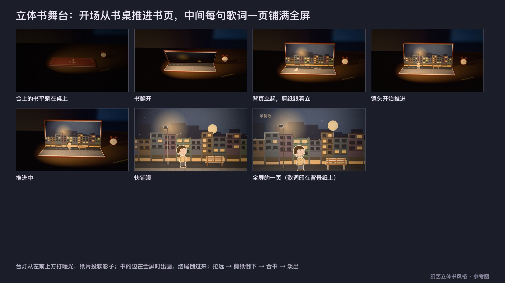
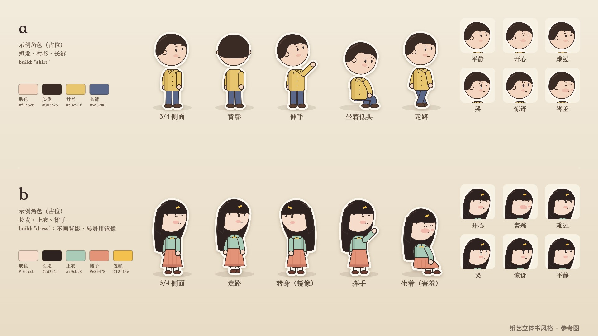
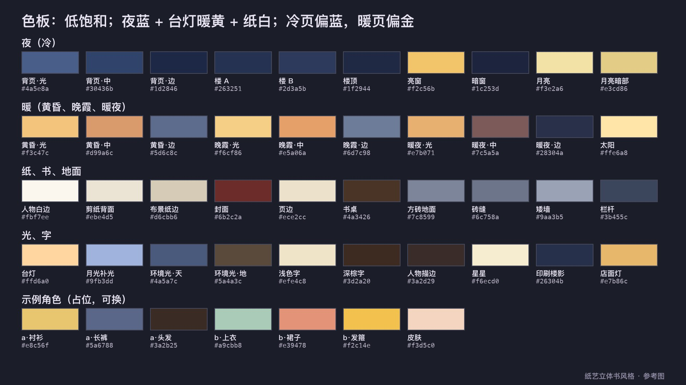
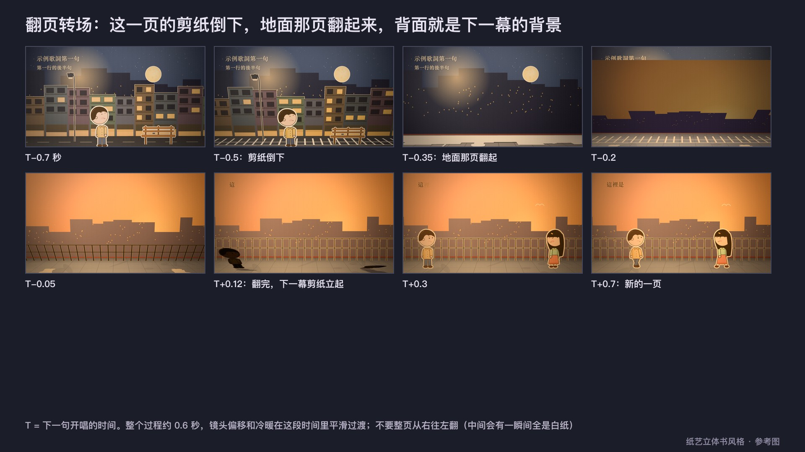
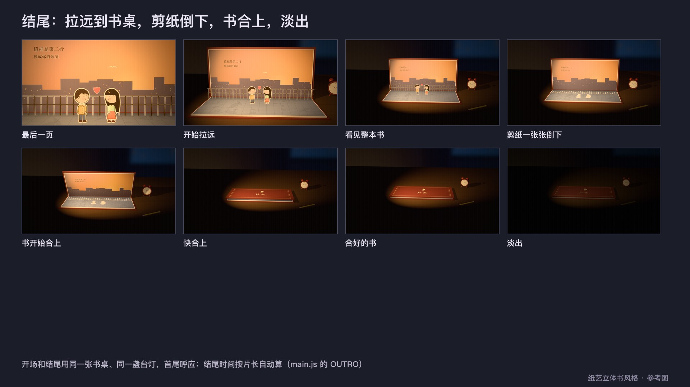
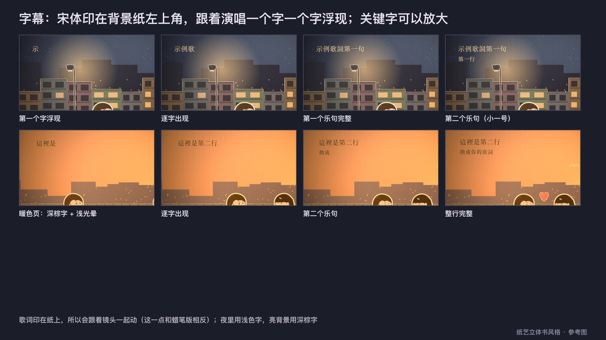

# 纸艺立体书版（paper）

起步代码在本 skill 的 `assets/paper/`，用 `new_project.py --style paper` 建项目，模板渲染验证过。参考图在 `references/style-paper/`。

这份文档只记风格：舞台、剪纸、配色、灯光、镜头、换页、字幕、后期，以及代码怎么写。人物、地点、画面上的字和故事，都由新片自己定。

- 参数是在 1920×1080、30 fps 下调出来的。
- 标"已验证"的写成过代码，渲染出来看过。
- 参考图都是用起步代码新画的示意图，不是任何成片的截图。两个角色 a、b、书名和所有场景都只是占位。

目录：一句话 · 适合做什么 · 画风规则 · 配色和光 · 镜头 · 换页转场 · 开场和结尾 · 其他画面手法 · 字幕 · 后期 · 代码结构 · 接口速查 · 写一页 · 套到新内容 · 不要做的事 · 踩过的坑

## 一句话

深夜的书桌上摊着一本立体书。台灯的暖光照在纸做的世界上，纸片人和布景从书页里一层层立起来；每句歌词翻一页。

## 适合做什么

- 回忆、讲故事、"翻开往事"的感觉；温柔、怀旧的歌。
- 地点多、场景变化多的歌：每句一页，换页很自然。
- 慢歌、中速歌。一拍一刀的快切不合适，因为翻一页要约 0.6 秒。
- 不适合大场面的连续运动、写实题材。

## 画风规则

**舞台（已验证）**



- 一本立体书就是整支 MV 的舞台：
  - 开场：书桌上合着的书 → 翻开 → 镜头推进书页；
  - 中间：每句歌词一页，铺满全屏，看不到书的边；
  - 结尾：拉远 → 剪纸倒下 → 合书 → 淡出。
- 每一页由三样东西组成：立着的背景纸（天空、墙，歌词印在上面）、铺地的纸、一层层立起来的剪纸。
- 镜头一直在慢慢推拉，每页只做一种慢动作。不硬切，不整屏叠化。
- 书桌上可以放一两件小道具（闹钟、铅笔……），点明时间和气氛，按新片的故事换。

**剪纸（已验证）**

- 人物：白色模切边（约 18 px，纸白 `#fbf7ee`），加柔和投影。
- 布景：纸边要窄而暗（4–5 px，`#d6cbb6`），否则在夜色里会亮得像霓虹灯。
- 剪纸背面是素白纸（`#ebe4d5`），和真的剪纸一样：倒下时看到的是白背面。
- 飘在空中的东西（音符、叶子、气泡、星星）不投影，否则在亮背景上会留下黑色的"洞"。
- 纸面都有纸纹：细噪点加细纤维（`paperGrain`）。
- 剪纸起立用 `ease.outBack`，最后会轻轻弹一下，像真的立体书。

**人物（已验证）**



- Q 版大头纸片人：深色描边加白色模切边，手臂短，手肘是圆弧。
- 长发角色不画背影（头发会把整个身子盖住，像鬼），转身直接镜像。
- 每个角色一种专属色，全片不换。
- 人物和道具都是单独的剪纸，姿势变了才重画贴图。

**灯光（已验证）**

- 台灯：左前上方的暖光 `#ffd6a0`（SpotLight），打出 PCF 软阴影，阴影强度 0.62。
- 月光：冷色补光 `#9fb3dd`，强度 0.35。
- 环境光：半球光，天 `#4a5a7c`、地 `#5a4a3c`。
- 每页分冷暖（`mood: "cool"` 或 `"warm"`），后期调色跟着变，换页时平滑过渡。

## 配色和光



| 用途 | HEX |
|---|---|
| 夜的背景纸 | 径向渐变 `#4a5e8a`（月光附近）→ `#30436b` → `#1d2846`（边缘） |
| 黄昏 / 晚霞 / 暖色的夜 | `#f3c47c` → `#d99a6c` → `#5d6c8c` / `#f6cf86` → `#e5a06a` → `#6d7c98` / `#e7b071` → `#7c5a5a` → `#28304a` |
| 月亮 | 剪纸 `#f8ebba` → `#e3cd86`，带白边；背景纸上印一圈月晕 `#f3e2a6`（30%） |
| 楼群剪纸 | `#263251` `#2d3a5b`，楼顶 `#1f2944`；亮窗 `#f2c56b`（约 13%），暗窗 `#1c253d` |
| 印刷的远景楼影 | `#26304b`（比剪纸更暗更淡） |
| 街边小楼 | `#5a6075` `#675b55` `#4f5b6c` `#5e5468` `#596a66`；店面灯 `#e7b86c` |
| 地面 | 方砖 `#7c8599`、砖缝 `#6c758a`；马路 `#3b404c`、人行道 `#77757a` |
| 矮墙 / 栏杆 | `#9aa3b5` / `#3b455c` |
| 书 | 封面暗红 `#6b2c2a`，页边 `#ece2cc`；书桌胡桃木 `#4a3426` |
| 纸 | 人物白边 `#fbf7ee`，剪纸背面 `#ebe4d5`，布景纸边 `#d6cbb6` |
| 字 | 浅色字 `#efe4c8`，深棕字 `#3d2a20` |
| 人物描边 | `#3a2d29` |
| 示例角色（占位） | a 衬衫 `#e8c56f`、长裤 `#5a6788`；b 上衣 `#a9cbb8`、裙子 `#e39478`、发箍 `#f2c14e` |

规律：低饱和；夜蓝、台灯暖黄、纸白三种颜色撑起全片。不用紫色渐变，也不用霓虹色。

## 镜头

**已验证**

- 舞台尺寸（世界单位）：`SCENE = { W: 13.6, H: 6.4, D: 6.4 }`。背景纸比画面宽，镜头平移不会露边；地面纸和背景纸一样高，像真书的两页。
- 基准机位：`BASE = { pos: [0.2, 3.05, 13.6], look: [0.1, 2.35, 0.5] }`，视场角 28°。人物站在 z ≈ 2.6–3.0 时，脚刚好入画。
- 每页的 `s.cam = lt => ({ dx, dy, dz, lx, ly })` 是相对基准机位的偏移。一般 6 秒推近 0.5–0.75 个单位，可以带一点横移或上摇。
- 换页那 0.6 秒里，前后两页的镜头偏移和冷暖平滑过渡（`main.js` 的 `sceneState`）。

## 换页转场（已验证）



真立体书的翻法（`kit.js` 的 `TRANS`）。以下一句开唱的时间 T 为准：

1. `fold: [T-0.6, T-0.32]`：这一页的剪纸倒下。
2. `lift: [T-0.5, T+0.12]`：地面那页往上翻起，盖到背景纸上。这页纸的背面（`setUnder`）印着下一幕的背景，所以翻起来的同时就露出了下一幕。
3. 下一页的剪纸提前 0.15 秒（`riseShift`）开始立起，等翻页快立直了才立，不会被挡住。

- 翻起途中，背面朝下照不到灯会发黑，所以给背面加一点自发光，立直时降到 0。
- 不要整页从右往左翻：中间会有一瞬间整个屏幕都是空白纸。

## 开场和结尾（已验证）



时间都写在 `main.js`，按片长自动算：

- `INTRO`：淡入 [0, 2.2]，翻开 [1.0, 4.2]，推进 [4.6, 8.4]（秒）。第一页在书快翻完时（4.2 − 0.8）立起来。书翻开到约 70° 以前，第一页的剪纸先藏起来，免得伸出书外。前奏长的歌，把这三段按比例放长。
- `OUTRO`：从片尾往前 8.97 秒开始拉远；倒数约 5.7 秒剪纸倒下；倒数 4.7 到 2.2 秒合书；最后 1.6 秒淡出。
- 机位：书桌全景 `DESK`、翻开的书 `OPEN`，和全屏一页的 `BASE` 之间插值。
- 冷暖：书桌那几秒用 0.55，然后过渡到第一页。
- 封面书名：`main.js` 的 `COVER = { title, subtitle }`，`new_project.py --title` 会帮你填。

## 其他画面手法（做过，模板里没有）

- **撕开一页**（适合放在情绪最高点）：背景纸从两个人中间撕成两半，各自漂远，裂口里露出后面的夜空。要点：
  - 用 `s.hideBackMesh = true` 换成两半背景，不要直接设 `visible = false`，场景框架每帧都会重设可见性；
  - 那几秒把 `book.back` 藏起来，不然露出的是书的页块；
  - 漂走的那一半不能往下沉，否则会掉到深色地面下面，看起来像"地板没了"。
- **月亮里浮现一张侧脸**：`drawFullMoon(ctx, W, H, true)` 在月亮里印一个淡淡的侧脸剪影。

## 字幕



**已验证**

- 宋体粗体（`Songti TC Bold` / `Songti SC Bold`），`index.html` 里叫 `MVSong`。
- 印在背景纸左上角，跟着画面一起动（像印在书页上）。这一点和蜡笔版相反。
- 跟着演唱一个字一个字浮现：每个字 0.16 秒，从下往上浮一点。
- 关键词放大 1.45 倍。写法是 `lyricLines(phrases, [[5, 6], []])`，数组里是要放大的字的下标。
- 第一句 76 px，第二句 62 px（按 2764×1300 的背景纸贴图算）。
- 夜景用浅色字 `#efe4c8` 加浅投影；黄昏、晚霞这类亮背景用深棕字 `#3d2a20` 加浅色光晕（场景的 `ink: "dark"`）。
- 下一行出来前，上一行用 `until` 淡出让位。

## 后期（`stage.js` 的 `FilmShader`，顺序固定）

1. 暗角（四角压到 0.58）
2. 去饱和：冷页留 84%，暖页留 97%
3. 冷暖：`uWarm` 冷页 0.12、暖页 0.92、书桌 0.55
4. 淡入淡出（`uFade`）
5. 颗粒：强度 0.04，按帧号变化，可以复现

色调映射用 `NeutralToneMapping`，曝光 1.15。阴影贴图 4096，半径 7。

## 代码结构（`assets/paper/`）

```
index.html          根合成：<canvas id="stage" data-layout-allow-overflow> + <audio id="song"> + import map（three 从 lib/three 本地加载）
data/timing.json    拍点、小节线、乐句（beats.py、set_lyrics.py 会重写它）；src/data/timing.js 由它生成
src/main.js         分镜表 SHOTS、开场和结尾（INTRO / OUTRO）、镜头混合、冷暖、封面书名 COVER、renderAt(t)
src/stage.js        渲染器、EffectComposer、FilmShader 后期、灯光 buildLights
src/book.js         书桌、虚化的房间、立体书外壳、桌上的道具：buildBookWorld(scene, { title, subtitle })
src/kit.js          PaperScene：一页全屏纸艺场景的骨架和换页转场（核心）；person()、flatCut()、floorCut()、lyricLines()、phrasesOf()
src/paper.js        纸：makeCanvas、toTexture、cutout()（alphaTest 剪纸，阴影跟着轮廓走）、paperBack()、dieCut()、dieCutLine()、paperGrain()
src/lyrics.js       逐字浮现、关键词放大、until 淡出
src/character.js    示意角色：drawPerson(ctx, W, H, "a"|"b", pose)
src/art.js          调色板 PAL、夜空、月亮、楼群剪纸、矮墙、天线、长椅、水箱、方砖地面、书桌、房间、钟面、封面
src/art-sky.js      天空 drawSkyBase（night / dusk / sunset / autumn）、光晕、半月、满月、云、纸心、星芒
src/art-street.js   街景背景纸、街边小楼（可选竖招牌）、路灯、纸音符、街道地面
src/art-room.js     室内：墙和窗、床、床头柜、纸团、木地板
src/art-misc.js     住宅外墙（窗洞）、窗里的屋子、信封、栏杆、海鸥、凉亭舞台、折椅、枫叶、照片、对话气泡
src/scenes/         两个示例页：nightStreet（夜·街角，冷）、duskRiverside（黄昏·河边，暖）
tools/sheet/        角色设定图页面（也要写 import map）
lib/three/          three.module.js、three.core.js、addons/（new_project.py 从 npm 复制进来，渲染不联网）
```

- `character.js` 的角色、`art*.js` 的场景美术、`scenes/` 的两页、`book.js` 的桌上道具和封面书名都是示意内容，新片换成自己的。`kit.js`、`paper.js`、`stage.js`、`lyrics.js`、`util.js` 是通用代码。
- 每一帧只由时间 t 决定：随机数用带种子的 `mulberry32`，不用 `Math.random`、计时器、`requestAnimationFrame`。
- 渲染：`npx --yes hyperframes@0.9.41 render --fps=30 --max-bitrate=16M`。M4 上 2 分钟整片约 3 分钟。
- 检查：`npx --yes hyperframes@0.9.41 check`。`font_face_local_only` 警告本机渲染可以忽略。

## 接口速查

**`new PaperScene(world, { id, tIn, tOut, index, mood: "cool"|"warm", ink: "light"|"dark" })`**

- `s.backdrop((ctx, w, h) => …)`：立着的背景纸。只画一次，歌词每帧印在它上面。`backPx(x, y)` 把世界坐标换成背景纸上的像素。
- `s.floor((ctx, w, h) => …)`：铺地的纸。
- `s.layer({ px: [贴图宽, 高], size: [世界宽, 高], pos: [x, y, z], rise: [开始, 结束], draw })`：立在地面上的剪纸。
  - `rise` 是相对 tIn 的起立时间。
  - `pos[1] > 0` 是悬空的剪纸，倒下超过一半时会自动藏起来。
- `person(s, who, { pos, rise, flip })`：人物剪纸，返回 `{ obj, pose(p) }`。
  - `pose()` 只在姿势变了的时候才重画，因为贴图上传很贵；
  - `obj.position.x` 可以让人在地面上走。
- `flatCut(s, draw, px, size, pos, { shadow })`：贴在背景纸前面的东西（月亮、云）。
- `floorCut(s, draw, px, size, pos)`：放在地面上、不参与起立的东西（掉落的信、纸团）。
- `s.lyrics(lyricLines(phrasesOf(timing, 行号), [[关键字下标], []]))`
- `s.animate = (t, lt) => …`：每帧更新。`s.closeK` 从 0 到 1，表示这一页正在翻走。
- `s.cam = (lt) => ({ dx, dy, dz, lx, ly })`：这一页的镜头偏移。
- `s.decorate = (ctx, t) => …` 加 `s.decorKey`：在歌词之后往背景纸上画东西（比如裂缝）。
- `s.hideBackMesh = true`：这一页自己换背景。

**人物 `drawPerson(ctx, W, H, who, pose)`**：设计稿 600×900，`who` 是 `PALETTES` 里的名字。

| pose | 意思 |
|---|---|
| `mood` | neutral、sad、smile、cry、shy、surprise |
| `view` | "3q"（默认）或 "back"（只对 shirt 体型有效） |
| `reach`、`lift`、`sit` | 伸手、踮脚、坐下（0–1） |
| `walk` | 走路的相位，null = 站着 |
| `tilt` | 头的角度，负数是仰头 |
| `gaze` | 视线，正数是往下看 |
| `blink`、`flip`、`border` | 眨眼、朝左（镜像）、白边宽度 |

加角色：在 `PALETTES` 里加一条，`build` 选 "shirt"（短发、衬衫、长裤）或 "dress"（长发、上衣、裙子、袜子），再填颜色。

## 写一页（照 `src/scenes/nightStreet.js`）

```js
export function nightStreet(world, timing, { tIn, tOut, index, line = 1 }) {
  const s = new PaperScene(world, { id: "night-street", tIn, tOut, index, mood: "cool", ink: "light" });
  s.backdrop((c, w, h) => drawStreetSky(c, w, h, 21, backPx(-2.2, 3.7)));      // 背景纸（歌词印在上面）
  s.floor((c, w, h) => drawStreetFloor(c, w, h, 18, SCENE.D));                  // 地面纸
  s.layer({ px: [3584, 870], size: [14, 3.4], pos: [0, 0, 0.3], rise: [0, 0.6], draw: (c, w, h) => drawStreetHouses(c, w, h, 63) });
  s.layer({ px: [384, 1536], size: [1.05, 4.2], pos: [-2.2, 0, 1.6], rise: [0.1, 0.72], draw: drawStreetLamp });
  const a = person(s, "a", { pos: [-3.3, 0, 2.75], rise: [0.25, 0.85] });
  const moon = flatCut(s, (c, w, h) => drawFullMoon(c, w, h), [512, 512], [1.1, 1.1], [2.5, 1.6, 0.16], { shadow: false });
  s.lyrics(lyricLines(phrasesOf(timing, line), [[], []]));
  s.animate = (t, lt) => {
    a.obj.position.x = -3.3 + 2.7 * ease.out(ramp(lt, 0.9, 3.2));             // 人在地面上走
    a.pose({ walk: lt > 0.9 && lt < 3.1 ? (lt - 0.9) * 1.7 : null });
    moon.position.y = keyed([[0, 1.6], [6, 3.9]], lt);                          // 月亮从楼后升起
  };
  s.cam = (lt) => ({ dz: -0.6 * ease.sine(Math.min(1, lt / 5.6)) });           // 每页只做一种慢动作
  return s;
}
```

然后在 `main.js` 的 `SHOTS` 里加 `{ make: (w, t, o) => nightStreet(w, t, { ...o, line: 3 }), tIn: LINE(3), tOut: LINE(4) }`。最后一页的 `tOut` 写 `1e9`。

## 套到新内容

1. 改封面书名（`COVER`）和书桌上的道具（`book.js`），让开场一眼就点明这首歌的时间和气氛。
2. 定冷暖：哪几页是冷（夜、现在、孤单），哪几页是暖（黄昏、回忆、温暖的时刻）。冷暖可以当情绪线。
3. 定角色：改 `PALETTES` 里两个示例角色，或者照两种体型加新角色；用 `tools/sheet` 出设定图给用户确认。
4. 每句歌词一页：
   - 背景纸画天空或墙，地面纸画地；
   - 剪纸从远到近排 2–5 层；
   - 主角站在 z ≈ 2.6–3.0。
5. 新地点照 `art*.js` 的写法画：剪纸用 `dieCut` 加白边，再上纸纹；布景纸边要窄而暗。
6. 情绪最高处可以用"撕开一页"，一支片最多一次。
7. 流程照本 skill 的六步：
   1. 用 `new_project.py --style paper --title 片名` 建项目，模板自带两页示例；
   2. 先做一页样片，对齐质感；
   3. 出角色设定图；
   4. 逐页做，先出关键帧总览；
   5. 总览确认后再渲整片。

## 不要做的事

- 生图模型；深色底配霓虹、紫色渐变；满屏文字。
- 没有衔接的硬切；整屏叠化；镜头来回推拉或晃动。
- 整页从右往左翻。
- 布景纸边又宽又白（在夜色里像霓虹灯）。
- 长发角色的背影。

## 踩过的坑

1. **平躺的剪纸会闪。** 剪纸和地面纸在同一个平面上抢显示（z-fighting）。平躺时稍微抬高，每层再错开一点（`kit.js` 里的 `0.008 + 0.004 * order`）；相邻两页的地面也上下错开 0.004。
2. **悬空的剪纸倒下时会浮在半空。** 比如窗里的人。倒下超过 45% 就先藏起来，`kit.js` 已经处理。
3. **剪纸背面不是白纸。** 平躺时会露出镜像的图案，看着脏。`paperBack()` 生成白背面。
4. **飘在空中的东西投了影。** 在亮背景上会留下黑色的"洞"。这类剪纸不要投影；阴影整体强度约 0.6。
5. **亮背景上的歌词看不清。** 黄昏、晚霞用深棕字加浅色光晕。
6. **翻页时出现空白屏、背面发黑。** 不要整页翻，改成地面那页翻起；背面加一点自发光，立直时降到 0。
7. **下一页的剪纸立得太早。** 会被还在翻的页挡住，翻完才突然冒出来。等翻页快立直了再立（`riseShift`）。
8. **场景想自己换背景。** 用 `hideBackMesh`，不要直接设 `visible = false`。
9. **撕开一页时露出书的页块，或者地板没了。** 那几秒藏起 `book.back`；漂走的那一半不能往下沉。
10. **手臂太长、手肘割裂。** 伸出去的手和垂下的手一样长；手臂画成经过手肘的二次曲线，控制点 = 2·肘 −（肩 + 手）/ 2；坐着时手放在大腿上。
11. **书合着时纸片伸出书外。** 书翻开到约 70° 以前先把纸片藏起来（`layersHidden`）。
12. **单独的页面截出来是空白图。** 设定图、分镜总览这类页面也要写 import map，否则 `three` 加载失败。
13. **镜头平移时露边。** 背景纸要比画面宽（13.6 大于 z = 0 处画面约 12.06 的宽度）。
14. **文件太大。** 带颗粒的画面码率很高，渲染时加 `--max-bitrate=16M`。
15. **check 报 canvas 贴边（`canvas_content_at_edge`）。** 全屏画面本来就画到边，给 canvas 加 `data-layout-allow-overflow`。
